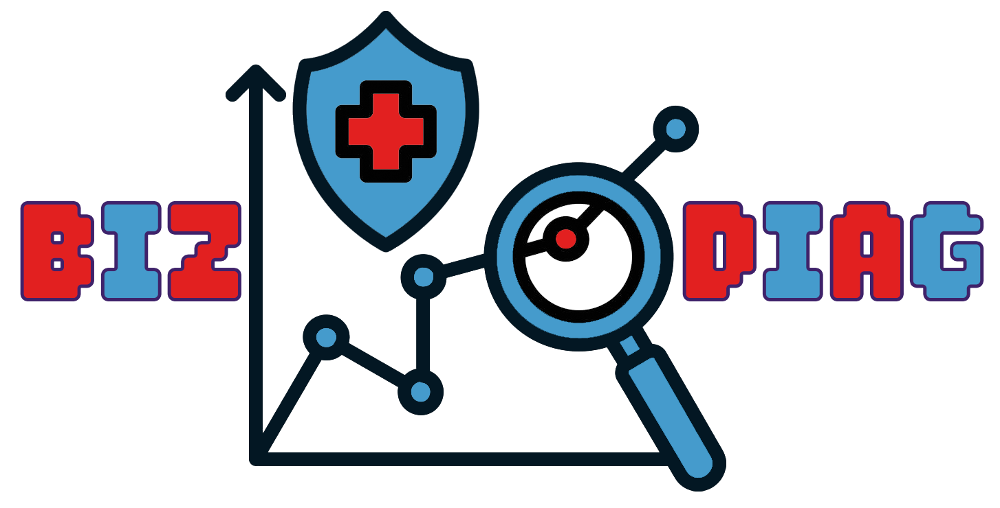

<div align="center">

<h1>BizDiag</h1>

<h2>Research-Driven Enterprise Architecture Intelligence for Digital Strategy & Business Diagnostics</h2>

</div>
<br/>
<p align="center">
  
</p>

BizDiag™ is an open-source software suite that transforms ArchiMate® models into structured, analyzable data to support 
Enterprise Architecture (EA) intelligence, Business–IT alignment analysis, Business Model Canvas (BMC) synthesis, 
Intelligent EA Architecture Blueprint, Capability-Based Planning, and AI-assisted architecture documentation. BizDiag™ 
is composed of modules that perform Enterprise Architecture automation, architecture intelligence, Business–IT alignment
analysis, business model analysis, EA client/server application architecture blueprints, and digital strategy support.
BizDiag™ is the open-source core of the open-core "BizDiag Industry Intelligence™". “BizDiag Industry Intelligence™” is 
an umbrella product with high-end EA applications for specific industries, e.g., “BizDiag Tourism Intelligence™”, 
“BizDiag Manufacturing Intelligence™”, and “BizDiag Banking Intelligence™”.

BizDiag™ extracts data from EA models, and transforms ArchiMate® models into structured, analyzable data that can be 
queried, transformed, enriched with AI, and used to support architecture analysis and strategic decision-making [1].

A central principle of BizDiag™ is to make Enterprise Architecture information programmable. This makes it possible to
develop reusable automation around Enterprise Architecture models. Built around ArchiMate®, Archi, jArchi, GraalVM®, 
GraalJS®, Java®, JavaScript®, databases, and AI integration, BizDiag brings software automation into the Enterprise 
Architecture workflow. An Enterprise Architecture model should not merely describe an organization. It should be usable 
as structured data for analysis, automation, decision support, and strategy.

---

## Table of Contents

- [1. Overview](#1-overview)
- [2. Research Foundation](#2-research-foundation)
- [3. Key Capabilities](#3-key-capabilities)
    - [3.1 Business_IT_Alignment](#business-it-alignment)
        - [3.1.1 A Business–IT Alignment/Misalignment Analysis](#business-it-alignment-analysis)
        - [3.1.2 Business-IT Alignment Research Methodology](#business-it-alignment-research-methodology)
    - [3.2 ClientServer_DB: Client/Server and Data Integration Modules](#clientserver-db)
        - [3.2.1 DB_Log](#clientserver-db-log)
        - [3.2.2 GraalJS_ClientServer_Template](#clientserver-db-graaljs-clientserver-template)
        - [3.2.3 GraalJS_Element_RESTLogger](#clientserver-db-graaljs-element-restlogger)
        - [3.2.4 GraalJS_NIOLoggerServer](#clientserver-db-graaljs-niologgerserver)
        - [3.2.5 Java_DBLoggerServer](#clientserver-db-java-dbloggerserver)
    - [3.3 BizDiag Local AI: Leveraging AI REST API for Smart Enterprise Architecture Operations](#bizdiag-local-ai)
        - [3.3.1 UML Subsystem](#uml-subsystem)
        - [3.3.2 DocMaker Subsystem](#docmaker-subsystem)
        - [3.3.3 Capability-Based Planning](#capability-based-planning)
            - [3.3.3.1 CBP Data-Entry Properties and Values](#cbp-data-entry-properties-and-values)
    - [3.4 BizModelCanvas](#bizmodelcanvas)
        - [3.4.1 A Business Model Canvas Generation & Analysis](#business-model-canvas-generation--analysis)
- [4. Why ArchiMate & jArchi?](#4-why-archimate--jarchi)
- [5. Technology Stack](#5-technology-stack)
- [6. Data Flow](#6-data-flow)
- [7. Modular Architecture](#7-modular-architecture)
- [8. Extensibility](#8-extensibility)
- [9. Client / Server Capabilities](#9-client--server-capabilities)
- [10. Intended Users](#10-intended-users)
- [11. Example Use Cases](#11-example-use-cases)
    - [11.1 Enterprise Architecture Assessment](#111-enterprise-architecture-assessment)
    - [11.2 Business–IT Alignment](#112-businessit-alignment)
    - [11.3 Architecture Data Analysis](#113-architecture-data-analysis)
    - [11.4 AI-Assisted Documentation](#114-ai-assisted-documentation)
    - [11.5 Business Model to Architecture](#115-business-model-to-architecture)
    - [11.6 Architecture Reporting](#116-architecture-reporting)
    - [11.7 Custom Architecture Automation](#117-custom-architecture-automation)
- [12. Installation](#12-installation)
- [13. Model Input](#13-model-input)
- [14. Repository Structure](#14-repository-structure)
- [15. Open Source & Commercial Services](#15-open-source--commercial-services)
- [16. Design Principles](#16-design-principles)
    - [16.1 Model as Data](#161-model-as-data)
    - [16.2 Automation First](#162-automation-first)
    - [16.3 Open Architecture](#163-open-architecture)
    - [16.4 Practical Intelligence](#164-practical-intelligence)
    - [16.5 Human-in-the-Loop](#165-human-in-the-loop)
    - [16.6 Modular Design](#166-modular-design)
    - [16.7 Technology Independence](#167-technology-independence)
- [17. Current Scope](#17-current-scope)
- [18. Roadmap](#18-roadmap)
- [19. Contributing](#19-contributing)
    - [19.1 APA](#191-apa)
    - [19.2 MLA](#192-mla)
    - [19.3 Chicago](#193-chicago)
    - [19.4 IEEE](#194-ieee)
- [20. License](#20-license)
- [21. Project](#21-project)
- [22. Related Documentation](#22-related-documentation)
- [23. Disclaimer](#23-disclaimer)
- [24. Author](#24-author)
- [25. References](#25-references)

---

## 1. **Overview**

Enterprise Architecture models often contain a significant amount of valuable organizational knowledge, but that 
information can remain difficult to analyze systematically.

BizDiag addresses this by treating the architecture model as structured data rather than only as a visual diagram. 
Automated analysis identifies suspicious structures, while architects and stakeholders determine their actual 
significance and appropriate remedies. This briefly states BizDiag's philosophy and the importance of the "human in the
loop" maxim.

The general workflow is:

```text
ArchiMate Model
      │
      ▼
BizDiag modules
      ├── Business_IT_Alignment
      ├── ClientServer_DB
      │   ├── DB_Log
      │   ├── GraalJS_ClientServer_Template
      │   ├── GraalJS_Element_RESTLogger
      │   ├── GraalJS_NIOLoggerServer
      │   └── Java_DBLoggerServer
      ├── BizDiag_Local_AI
      │   ├── Capability_Based_Planning
      │   │   └── lib
      │   │       ├── CBP_Capability_Discovery.js
      │   │       └── CBP_Ollama_Worker.js
      │   ├── DocMaker
      │   └── UML
      └── BizModelCanvas
      │
      ▼
Architecture Intelligence and decision support
```

BizDiag is designed as a modular suite. Individual capabilities can be used independently, while multiple components can 
be combined to create organization-specific Enterprise Architecture workflows.

**What Makes BizDiag Different?**

BizDiag is a research-driven software suite designed to empower enterprise architects by translating academic 
research, authoritative white papers, and author's original ideas into practical tools and methods for enterprise 
architecture analysis, modeling, diagnostics, and decision support. Rather than focusing solely on automating 
operations on ArchiMate models, BizDiag brings together multiple research-informed capabilities that address 
different aspects of enterprise architecture practice. By combining established theoretical foundations with 
original contributions and executable open-source solutions, BizDiag seeks to bridge the gap between academic 
knowledge and the practical challenges faced by enterprise architects.

---

## 2. Research Foundation

BizDiag builds on established academic research in Enterprise Architecture, software architecture, and Design 
Science Research. Its Business–IT Alignment module, UML module, and BizModelCanvas operationalize these 
foundations through an original, research-driven assessment methodology developed by the author. A forthcoming 
white paper will elaborate on the methodology and its research contributions [3, 6, 12–14, 21, 33, 34].

---

## 3. Key Capabilities


<a id="business-it-alignment"></a>
### 3.1 **Business_IT_Alignment**

<a id="business-it-alignment-analysis"></a>
#### 3.1.1 A Business–IT Alignment/Misalignment Analysis

BizDiag's Business_IT_Alignment subsystem includes analysis capabilities intended to help architects investigate
relationships between business and IT architecture [2, 8–10, 14, 16–18]. This module has leveraged the previously-conducted studies on
the Business–IT alignment research methodology, mostly the studies by Őri and Szabó. However, my analysis and 
utilized technology stack drastically differ from those used by the mentioned researchers. Unlike approaches that
rely on Schematron/XPath-style rule-based validation, BizDiag’s Business–IT Alignment module employs a five-stage
analysis methodology implemented using jArchi, GraalJS, and JSON-based rules. Its methodology draws on the three 
cycles of Hevner et al.’s Design Science Research framework: the **Relevance Cycle**, which connects the 
assessment to practical EA alignment concerns; the **Design Cycle**, which supports the development and 
application of a literature-informed catalogue of misalignment symptoms; and the **Rigor Cycle**, which grounds 
symptom selection and classification in established academic literature. Together, these cycles inform the 
module’s systematic identification, classification, and assessment of Business–IT misalignments [3–6, 15].

The analysis can identify structural conditions that may indicate potential Business–IT alignment issues. 
Detected conditions can be classified according to configurable severity levels such as:

- Low
- Medium
- High
- Critical

These classifications should be interpreted as analytical indicators rather than automatic business judgments.

BizDiag does not claim that an automatically detected condition is necessarily a business problem. Its purpose is
to identify conditions that architects and decision-makers can investigate further. This approach can help 
architecture teams systematically examine areas such as:

- Business capabilities and supporting applications
- Business services and application services
- Application dependencies
- Technology dependencies
- Missing or weak architectural relationships
- Potentially unsupported business structures


<a id="business-it-alignment-research-methodology"></a>
#### 3.1.2 Business-IT Alignment Research Methodology

The Business-IT Alignment module implements a five-phase Enterprise Architecture (EA) assessment process, conceptually based on extensive conducted research. This module is grounded in original research conducted by the Ebrahim Pak (2026).The five main phases are as follows [3–6, 15]:

- **Phase 1**: Preliminary Review — The assessment is organized around six core EA domains:
  Strategy (core-based on paper 1: S.01–S.10, supplementary-based on paper 2: STR.61–STR.67),
  Business Process (B.11–B.20), Data Governance (D.21–D.30), Application Portfolio (A.31–A.40),
  Technology Infrastructure (T.41–T.48), and Cross-Layer Alignment (X.49–X.60). The script
  inspects modeled elements and relationships in these domains. Additional Operational and
  Semantic checks and artifact-framework checks extend the core code families [4, 5, 15].


- **Phase 2**: Malfunctioning-Area Analysis — The script applies rules to the model’s elements,
  relationships, and—where needed—declared properties to identify potential alignment gaps.
  Findings use several code patterns, including S.01, STR.61, SEM.03, and ABF.S.12; the prefix
  identifies a rule family, and the number identifies the check.


- **Phase 3**: Symptom Categorization — Each finding is associated with catalogue metadata: its EA
  aspect, severity (CRITICAL, HIGH, MEDIUM, or LOW), description, and analyzability classification.
  Some framework-related catalogue entries also include research mappings.


- **Phase 4**: Analyzability and Severity Filtering — The catalogue distinguishes checks marked
  analyzable from those marked non-analyzable, such as checks that may depend on metadata or
  modeling context. This flag is a classification, not a guarantee that every analyzable check
  is determined by relationships alone. In the English script, non-analyzable findings are
  included by default, and the minimum severity is LOW; the report controls allow filtering.


- **Phase 5**: Assessment and Reporting — Findings are summarized by severity and aspect, shown in
  the interactive report, and exported to CSV and Excel. The script also records finding codes
  and notes on affected model elements and applies severity-based visual colors.

Therefore, each finding captures a misalignment JSON object as follows:

```json
{
"elementId": "arch-123",   
"elementName": "Order Processing",   
"elementType": "BusinessProcess",   
"code": "B.13",   
"severity": "HIGH",   
"desc": "Process without application support",   
"documentation": "No Application Service linked",
"analyzable": true,   
"aspect": "derivedAspect"
}
```


### 3.2 **ClientServer_DB**: Client/Server and Data Integration Modules

<a id="clientserver-db"></a>

`ClientServer_DB/` groups related components that extract architecture data from ArchiMate models and make it available
through client/server workflows, REST or TCP communication, JSON/JSONL exports, and H2 databases.

<a id="clientserver-db-log"></a>
#### 3.2.1 DB_Log

DB_Log can transform architecture information into structured data suitable for programmatic analysis. Architecture 
data can be loaded into an in-memory database, like the utilized H2 database, or any other relational database systems, 
and queried using SQL, in a Java Swing GUI.

Moreover, the H2ConsoleLauncher.java runs the H2 database and opens the H2 console in a web browser, receiving the set
credentials, allowing users to query the architecture data using SQL, through a web interface.

The high-level structure of the DB_Log workflow is as follows:

```text
ArchiMate Model
        │
        ▼
Architecture Data Extraction
        │
        ▼
Structured Data
        │
        ▼
H2 Database / Java GUI
        │
        ▼
SQL Analysis
        │
        ▼
Enterprise Architecture Insights
```

This makes it possible to apply familiar data-analysis techniques to Enterprise Architecture information.

Potential applications include:

- Dependency analysis
- Element inventories
- Relationship analysis
- Architecture metrics
- Custom queries
- Data validation
- Automated reporting
- Organization-specific analytical models

<a id="clientserver-db-graaljs-clientserver-template"></a>
#### 3.2.2 GraalJS_ClientServer_Template

This is a client/server template for Archi. The client is a jArchi script, while the server is a GraalJS application
with JavaScript outer structure and Java inner structure. The example is a time-server/time-client application that
demonstrates writing both jArchi code and non-jArchi code in distinct GraalJS environments within one codebase. Although
the server could be implemented in vanilla Java, this design demonstrates using different GraalJS dialects in one
project and is useful where a uniform language is preferred or required.

Its NIO-based TCP server uses Java's non-blocking I/O architecture: a `ServerSocketChannel` accepts connections and a
`Selector` monitors connection events. A single event loop registers client channels for reads, receives their payloads,
and prints the UTF-8 text when a client closes its connection. This event-driven design avoids a separate thread per
client and provides a basis for connection-management and lightweight TCP integration examples.

<a id="clientserver-db-graaljs-element-restlogger"></a>
#### 3.2.3 GraalJS_Element_RESTLogger

This module pairs `GraalJSRESTClient.ajs` with `GraalJSRESTServer.js`. The jArchi client sends extracted model-element
data to the GraalJS REST server, which records the received data in H2 for later analysis.

<a id="clientserver-db-graaljs-niologgerserver"></a>
#### 3.2.4 GraalJS_NIOLoggerServer

This module exports element information for further analysis and integration. Its click-dumper client,
`nio_interop_client.js`, receives element click events in Archi and writes them to both an H2 database and a JSONL file.
The server runs a non-blocking NIO selector loop outside Archi/jArchi; logging uses JDBC and file I/O in the event loop.
Connections are handled without a dedicated thread per client; synchronous database and file operations can briefly
pause the event loop. The data flow is `log_click.ajs` → `nio_interop_client.js` → `nio_interop_server.js` → H2 and
JSONL. JSONL supports AI pipelines, data processing, machine learning, large-scale architecture analysis, external-tool
integration, and marketing use cases. The extracted data can also be converted or imported into spreadsheet tools for
architecture reviews, reporting, data inspection, stakeholder analysis, and further processing with common business
tools.

<a id="clientserver-db-java-dbloggerserver"></a>
#### 3.2.5 Java_DBLoggerServer

This module connects a jArchi client to a standalone Java server for database-backed logging. The client sends selected
element metadata as Base64 through `log_click.ajs`; the `nio_interop_client.js` transport adapter decodes the payload
and sends it over TCP to `NioInteropServer.java`. The server runs outside Archi and jArchi as a vanilla Java program,
providing a deployment option for environments that require a pure-Java server rather than a GraalJS runtime.


<a id="bizdiag-local-ai"></a>
### 3.3 **BizDiag Local AI**: Leveraging AI REST API for Smart Enterprise Architecture Operations

The BizDiag Local AI subsystem follows a layered, microservice-inspired architecture that separates Enterprise
Architecture model interaction from AI inference. It is organized around three capabilities:

- an AI-enhanced ArchiMate Application View to UML transformation script
- an AI-driven DocMaker subsystem for generating documentation
- the Capability-Based Planning workflow with optional Move 1 Ollama Capability discovery

```
BizDiag_Local_AI/
├── Capability_Based_Planning/
│   ├── CBP_Move_1_Setup.ajs
│   ├── CBP_Continue_Moves_2_to_7.ajs
│   └── lib/
│       ├── CBP_Capability_Discovery.js
│       ├── CBP_Improvement_Tables.js
│       ├── CBP_Strategic_Importance_Maturity_Diagrams.js
│       ├── CBP_Assessment_Engine.js
│       ├── CBP_Model_Inputs.js
│       ├── CBP_Run_State.js
│       ├── CBP_View_Generator.js
│       └── CBP_Ollama_Worker.js
├── DocMaker
│   ├── AI_Element_DocMaker_EN.ajs
│   ├── AI_Element_DocMaker_FA.ajs
│   ├── AI_View_DocMaker_EN.ajs
│   ├── AI_View_DocMaker_FA.ajs
│   ├── AI_REST_JSON.js
│   ├── Ollama_Olalla.ajs
│   └── Mark_it_Down.ajs
└── UML
    ├── Application_View_to_UML.ajs
    └── sendToAI.js
```

_The Scripts_

AI-assisted capabilities can be used to support tasks such as:

- Architecture documentation
- Element description generation
- Architecture information enrichment
- Analysis assistance
- Natural-language interaction with architecture information
- Generation of structured architecture-related content
- Leveraging locally-installed Ollama, together with local AI Models

The architecture workflow supports offline AI models. BizDiag_Local_AI uses Java NIO.2 for robust filesystem and
directory management. The following are the jArchi scripts and JavaScript files of this application:

<table width="100%">
  <colgroup>
    <col width="28%">
    <col width="72%">
  </colgroup>
  <thead>
    <tr>
      <th>Script</th>
      <th>Description</th>
    </tr>
  </thead>
  <tbody>
    <tr>
      <td><code>AI_<br>Element_<br>DocMaker_<br>EN.ajs</code></td>
      <td>Generates AI analysis for the selected element in Archi, in English</td>
    </tr>
    <tr>
      <td><code>AI_<br>Element_<br>DocMaker_<br>FA.ajs</code></td>
      <td>Generates AI analysis for the selected element in Archi, in Persian</td>
    </tr>
    <tr>
      <td><code>AI_<br>View_<br>DocMaker_<br>EN.ajs</code></td>
      <td>Generates AI analysis for the selected view in Archi, in English</td>
    </tr>
    <tr>
      <td><code><AI_<br>View_<br>DocMaker_<br>FA.ajs</code></td>
      <td>Generates AI analysis for the selected view in Archi, in Persian</td>
    </tr>
    <tr>
      <td><code>AI_<br>REST_<br>JSON.js</code></td>
      <td>Provides REST API communication with Ollama, handles JSON serialization/deserialization, manages element context tracking, and persists AI-generated documentation to files (used by DocMaker)</td>
    </tr>
    <tr>
      <td><code>Mark_<br>it_<br>Down.ajs</code></td>
      <td>Provides Markdown export functionality for selected Archi views and elements</td>
    </tr>
    <tr>
      <td><code>Ollama_<br>Olalla.ajs</code></td>
      <td>Provides integration with the locally installed Ollama AI runtime</td>
    </tr>
    <tr>
      <td><code>send<br>To<br>AI.js</code></td>
      <td>Simple HTTP client wrapper for querying Ollama (used by Application_View_to_UML.ajs only; independent of AI_REST_JSON.js)</td>
    </tr>
    <tr>
      <td><code>CBP_<br>Capability_<br>Discovery.js</code></td>
      <td>Builds a bounded strategic-label and Business Model Canvas context, validates grounded Ollama proposals, and creates traceable provisional Capability elements.</td>
    </tr>
    <tr>
      <td><code>CBP_<br>Improvement_<br>Tables.js</code></td>
      <td>Renders the CBP roadmap, dimension-increment, and required-action tables from assessment results and accepted Goals/actions.</td>
    </tr>
    <tr>
      <td><code>CBP_<br>Strategic_<br>Importance_<br>Maturity_<br>Diagrams.js</code></td>
      <td>Renders the strategic-importance, maturity, and increment-roadmap diagrams from CBP assessment results.</td>
    </tr>
    <tr>
      <td><code>CBP_<br>Assessment_<br>Engine.js</code></td>
      <td>Calculates CBP maturity, strategic importance, landscape classifications, target Goals, and actions for Moves 2–7.</td>
    </tr>
    <tr>
      <td><code>CBP_<br>Model_<br>Inputs.js</code></td>
      <td>Validates model properties and calculates maturity and strategic-importance assessment inputs.</td>
    </tr>
    <tr>
      <td><code>CBP_<br>Run_<br>State.js</code></td>
      <td>Provides CBP model queries, allowed element scope, and persisted workflow run state.</td>
    </tr>
    <tr>
      <td><code>CBP_<br>View_<br>Generator.js</code></td>
      <td>Generates the Capability map, input worklists, and analytical CBP views.</td>
    </tr>
    <tr>
      <td><code>CBP_<br>Ollama_<br>Worker.js</code></td>
      <td>Discovers installed local Ollama models and transports asynchronous generation requests with timeout and error handling.</td>
    </tr>
    <tr>
      <td><code>CBP_<br>Move_<br>1_<br>Setup.ajs</code></td>
      <td>Creates the Capability map and input worklists; optionally discovers provisional Capabilities from bounded strategic labels and Canvas content.</td>
    </tr>
    <tr>
      <td><code>CBP_<br>Continue_<br>Moves_<br>2_<br>to_<br>7.ajs</code></td>
      <td>Validates user-entered inputs, calculates Moves 2–7, and generates the analytical CBP views.</td>
    </tr>
  </tbody>
</table>


<a id="uml-subsystem"></a>
#### 3.3.1 UML Subsystem
The first BizDiag Local AI capability is `Application_View_to_UML.ajs`, a jArchi script that transformed the selected 
application-layer views into new views using UML-like notation instead of ArchiMate notation. It is an AI-enhanced 
UML-like view  generation script designed for architectural transformation and semantic enrichment. The script does not 
generate idiomatic UML, but instead it generates a UML-inspired component-diagram view from the selected ArchiMate 
Application View.

Application_View_to_UML.ajs
converts the currently selected ArchiMate view into a new UML-style view displayed directly in Archi’s Models panel.
The script uses Ollama through `sendToAI.js` to semantically analyze each element and generate more informed UML
stereotypes and enriched documentation. It reads a user-selected source view—typically a Phase C -
Information Systems Architecture view—extracts application-layer concepts and relationships, and creates a new Archi 
view using UML-style diagram notation enhanced with AI-generated semantic classifications.

**UML Module Research Methodology**

Kruchten’s 4+1 model informs the module’s view-oriented architectural context, while Open Group guidance informs its
ArchiMate/UML cross-notation context [21–23]. The script does not implement the complete 4+1 model or a formal
ArchiMate-to-UML transformation: it creates a UML-inspired, component-style ArchiMate view, optionally enriched with
AI-suggested semantic annotations. See the [UML module documentation](BizDiag_Local_AI/UML/UML_MODULE_DOCUMENTATION.md)
for scope, workflow, and limitations.


<a id="docmaker-subsystem"></a>
#### 3.3.2 DocMaker Subsystem
This application consists of `AI_View_DocMaker_EN.ajs`, `AI_Element_DocMaker_FA.ajs`, `AI_Element_DocMaker_EN.ajs`,
`AI_Element_DocMaker_FA.ajs`, `AI_REST_JSON.js`, `Ollama_Olalla.ajs`, and `Mark_it_Down.ajs`.
The DocMaker subsystem within BizDiag Local AI is organized into three principal layers. First, the jArchi layer 
operates inside Archi and consists of bilingual documentation scripts—`AI_Element_DocMaker_EN.ajs` / 
`AI_Element_DocMaker_FA.ajs` and `AI_View_DocMaker_EN.ajs` / `AI_View_DocMaker_FA.ajs`—which extract ArchiMate element 
and view metadata in response to user selection and coordinate processing through Ollama_Olalla.ajs. Second, 
the communication abstraction layer, implemented in pure JavaScript through `AI_REST_JSON.js`, serializes enterprise 
architecture data to JSON payloads, manages HTTP POST requests to a local Ollama endpoint, saves AI-generated responses 
to persistent JSON documentation files, and tracks element context (element ID, name, type, view name, and timestamps).   
This design decouples model extraction from AI inference and supports loose coupling between the two functions. Third, 
the Ollama runtime executes outside Archi on the user's local machine, hosting LLMs that process documentation requests 
without cloud dependencies, external API keys, or exposure of sensitive architecture data to remote services.
Post-processing is performed by `Mark_it_Down.ajs`, which formats AI-generated output as structured Markdown and uses 
Java NIO.2 APIs for reliable file-system operations. Overall, this architecture emphasizes data privacy, reduced 
operational cost, offline functionality, and extensibility, allowing organizations to replace underlying LLMs, add 
language variants, or integrate alternative AI runtimes without modifying the core enterprise architecture extraction 
logic.


```
================================================================================
        BizDiag_Local_AI: High-Level Architectural Overview
================================================================================
```
```
┌─────────────────────────────────────────────────────────────────────────────┐
│                          ARCHI (jArchi Environment)                         │
│                                                                             │
│   ┌──────────────────────────────────────────────────────────────────┐      │
│   │              User: Select Element or View in Archi               │      │
│   └────────────────────┬─────────────────────────────────────────────┘      │
│                        │                                                    │
│        ┌───────────────┴───────────────┐                                    |
│        │                               │                                    │
│        ▼                               ▼                                    │
│   ┌─────────────────┐         ┌──────────────────┐                          |
│   │ Element DocMaker│         │ View DocMaker    │                          │
│   │                 │         │                  │                          │
│   │ EN.ajs / FA.ajs │         │ EN.ajs / FA.ajs  │                          │
│   │                 │         │                  │                          │
│   │ (jArchi Scripts │         │ (jArchi Scripts) │                          │
│   │  in Archi)      │         │ in Archi)        │                          │
│   └────────┬────────┘         └────────┬─────────┘                          │
│            │                           │                                    │
│            └───────────────┬───────────┘                                    │
│                            │                                                │
│                            ▼                                                │
│                   ┌─────────────────┐                                       │
│                   │ Ollama_Olalla   │                                       │
│                   │ .ajs            │                                       │
│                   │                 │                                       │
│                   │ Local AI        │                                       │
│                   │ Integration     │                                       │
│                   └────────┬────────┘                                       │
│                            │                                                │
└────────────────────────────┼────────────────────────────────────────────────┘
                             │
                             ▼
┌────────────────────────────────────────────┐
│     AI_REST_JSON.js                        │
│                                            │
│  REST API Communication Layer              │
│  JSON Payload Preparation & Parsing        │
│  Element Context Tracking & Persistence    │
│  Retry Logic with Timeout Handling         │
│  File I/O for Documentation Storage        │
└────────────────────┬───────────────────────┘
                     │
            (DocMaker scripts route here)
                     │
                     ▼
         Ollama Endpoint at localhost:11434
                     │
                     │ HTTP Request
                     │ (JSON Payload)
                     ▼
┌────────────────────────────────────────────┐
│    OLLAMA (Local AI Runtime)               │
│                                            │
│  ┌──────────────────────────────────────┐  │
│  │  Local AI Model (e.g., Llama2,       │  │
│  │  Mistral, Neural Chat, etc.)         │  │
│  │                                      │  │
│  │  Generate Documentation:             │  │
│  │  - Element descriptions              │  │
│  │  - View analysis                     │  │
│  │  - Architecture rationale            │  │
│  └──────────────────────────────────────┘  │
└────────────────────┬───────────────────────┘
                     │
                     │ HTTP Response
                     │ (AI-Generated Content)
                     ▼
┌────────────────────────────────────────────────┐
│  AI_REST_JSON.js (Response Handler)            │
│                                                │
│  Parse Response JSON                           │
│  Extract AI Output                             │
│  Save to documentation/{viewName}/json file    │
│  Track element metadata & timestamp            │
└────────────────────┬───────────────────────────┘
                     │
                     ▼
┌────────────────────────────────────────────────────────────────────────────┐
│  ARCHI (jArchi Environment) - Post-Processing                              │
│                                                                            │
│           ┌──────────────────────────────────────────────┐                 │
│           │   Mark_it_Down.ajs                           │                 │
│           │                                              │                 │
│           │   Markdown Export & Formatting               │                 │
│           │   - Format AI output as Markdown             │                 │
│           │   - Structure documentation                  │                 │
│           │   - Add metadata/headers                     │                 │
│           └────────────────┬─────────────────────────────┘                 │
│                            │                                               │
│                            ▼                                               │
│           ┌──────────────────────────────────────────────┐                 │
│           │   Java NIO.2 File System Operations          │                 │
│           │                                              │                 │
│           │   - Directory Management                     │                 │
│           │   - File I/O Operations                      │                 │
│           │   - Robust Path Handling                     │                 │
│           └────────────────┬─────────────────────────────┘                 │
│                            │                                               │
│                            ▼                                               │
│           ┌──────────────────────────────────────────────┐                 │
│           │   documentation/ (Output Folder)             │                 │
│           │                                              │                 │
│           │   ├── element_<name>.md                      │                 │
│           │   ├── view_<name>.md                         │                 │
│           │   └── [AI-Generated Markdown Files]          │                 │
│           └──────────────────────────────────────────────┘                 │
│                                                                            │
└────────────────────────────────────────────────────────────────────────────┘
```
```
================================================================================
                                DATA FLOW SUMMARY
================================================================================
```
```
User Input
│
├─→ Selects Element/View in Archi
│
├─→ Triggers DocMaker Script (EN/FA variant)
│
├─→ Extracts Element/View Metadata
│
├─→ Calls AI_REST_JSON.js with (prompt, element, isReplacement)
│
├─→ AI_REST_JSON.js Prepares JSON Payload
│
├─→ AI_REST_JSON.js Sends HTTP Request to Ollama
│
├─→ Ollama Processes with Local LLM
│
├─→ Ollama Returns AI-Generated Documentation (HTTP Response)
│
├─→ AI_REST_JSON.js Parses Response & Persists to documentation/ folder
│
├─→ AI_REST_JSON.js Tracks element context (ID, name, type, timestamp)
│
├─→ Formats as Markdown (Mark_it_Down.ajs) — optional post-processing
│
└─→ Documentation stored in documentation/{viewName}/ai_documentation.json
```
```
================================================================================
                         COMPONENT RESPONSIBILITIES
================================================================================
```
```
┌─────────────────────────────────────────────────────────────────────────────┐
│ jArchi Scripts (Run Inside Archi)                                           │
├─────────────────────────────────────────────────────────────────────────────┤
│                                                                             │
│ AI_Element_DocMaker_EN.ajs / FA.ajs                                         │
│   • Triggered when user selects an ArchiMate element                        │
│   • Extracts element name, type, description, relationships                 │
│   • Calls Ollama_Olalla to initiate AI processing                           │
│   • Returns formatted result to user                                        │
│   • Supports English (EN) and Persian (FA) output                           │
│                                                                             │
│ AI_View_DocMaker_EN.ajs / FA.ajs                                            │
│   • Triggered when user selects an ArchiMate view                           │
│   • Extracts view structure, contained elements, relationships              │
│   • Prepares comprehensive view metadata                                    │
│   • Calls Ollama_Olalla for AI analysis                                     │
│   • Supports English (EN) and Persian (FA) output                           │
│                                                                             │
│ Ollama_Olalla.ajs                                                           │
│   • Orchestrates communication with Ollama                                  │
│   • Manages request lifecycle                                               │
│   • Handles callbacks and error conditions                                  │
│   • Routes DocMaker requests through AI_REST_JSON.js layer                  │
│                                                                             │
│ Mark_it_Down.ajs                                                            │
│   • Formats AI-generated text into structured Markdown                      │
│   • Adds metadata headers (element type, date, author)                      │
│   • Creates proper file structure                                           │
│   • Handles language-specific formatting                                    │
│                                                                             │
└─────────────────────────────────────────────────────────────────────────────┘

┌─────────────────────────────────────────────────────────────────────────────┐
│ JavaScript Libraries (Communication & Utility)                              │
├─────────────────────────────────────────────────────────────────────────────┤
│                                                                             │
│ AI_REST_JSON.js                                                             │
│   • Serializes EA data to JSON (conforming to request payload format)       │
│   • Establishes HTTP connection to Ollama and sends POST requests           │
│   • Handles timeouts and retry logic with configurable retry attempts       │
│   • Deserializes Ollama responses from JSON                                 │
│   • Persists AI-generated documentation to JSON files via Java NIO.2        │
│   • Tracks element context (ID, name, type, view name, timestamps)          │
│   • Bridges jArchi data structures ↔ REST API contract                      │
│   • Used by: AI_Element_DocMaker_EN/FA.ajs, AI_View_DocMaker_EN/FA.ajs      │
│                                                                             │
└─────────────────────────────────────────────────────────────────────────────┘

┌─────────────────────────────────────────────────────────────────────────────┐
│ External Runtime (Local Machine)                                            │
├─────────────────────────────────────────────────────────────────────────────┤
│                                                                             │
│ Ollama                                                                      │
│   • Runs locally on the user's machine (e.g., localhost:11434)              │
│   • No cloud dependency, no API keys, no external service calls             │
│   • Hosts one or more AI models (configurable by user)                      │
│   • Exposes REST API endpoint: POST /v1/chat/completions (or similar)       │
│   • Processes each request in context window                                │
│   • Returns model-generated text in JSON response                           │
│                                                                             │
└─────────────────────────────────────────────────────────────────────────────┘
```
```
================================================================================
                     KEY ARCHITECTURAL CHARACTERISTICS
================================================================================
```
1. LOCALIZATION & OFFLINE OPERATION
   ✓ All AI processing occurs on user's local machine via Ollama
   ✓ No cloud API calls, no external service dependencies
   ✓ Full control over sensitive EA data
   ✓ Works without Internet connection

2. MULTI-LANGUAGE SUPPORT
   ✓ Bilingual scripts: English (EN) and Persian (FA) variants
   ✓ Documentation output respects language choice
   ✓ Extensible to additional languages

3. MODULARITY
   ✓ Each component has clear responsibility
   ✓ Loosely coupled via JSON/REST contracts
   ✓ Can be extended or replaced independently
   ✓ Supports different Ollama models

4. SEPARATION OF CONCERNS
   ✓ jArchi scripts handle EA model interaction (inside Archi)
   ✓ JavaScript libraries handle REST/JSON communication
   ✓ Ollama handles AI inference (external runtime)
   ✓ File system I/O via Java NIO.2 (robust and async-ready)

5. WORKFLOW INTEGRATION
   ✓ Seamlessly integrated into Archi UI (native jArchi)
   ✓ Output automatically saved to project folder
   ✓ Can chain with other BizDiag components
   ✓ Results exportable for further processing

```
================================================================================
                       TYPICAL INTERACTION SEQUENCE
================================================================================
```
```
User in Archi
│
├─ Right-click on Business Service "Customer Portal"
│
├─ Select "AI_Element_DocMaker_EN" from Scripts menu
│
├─→ ElementDocMaker extracts: { name, type, description, relationships }
│
├─→ ElementDocMaker calls AI_REST_JSON with (prompt, element, isReplacement)
│
├─→ AI_REST_JSON serializes to JSON
│
├─→ AI_REST_JSON posts to http://localhost:11434/api/generate
│
├─→ Ollama LLM processes: "Describe this ArchiMate Business Service..."
│
├─→ Ollama returns: JSON with generated documentation text
│
├─→ AI_REST_JSON receives response and deserializes JSON
│
├─→ AI_REST_JSON saves to: documentation/business-service-customer-portal/ai_documentation.json
│
├─→ AI_REST_JSON tracks: { elementId, elementName, elementType, timestamp, content, viewName }
│
├─→ Mark_it_Down formats as Markdown with headers/metadata (optional post-processing)
│
└─ User sees success message in Archi console
```
Result: documentation/business-service-customer-portal.md
- Professional Markdown documentation
- AI-generated content
- Ready for sharing / publication


_Why Ollama?_

Ollama was chosen as the local AI runtime instead of requiring a cloud-based AI service and an external API key. As a 
Digital Business Practitioner, I wanted AI-assisted documentation to provide greater control over potentially sensitive 
Enterprise Architecture information and reduce dependency on external services.

Other considerations, including operational cost, performance, local execution, and the ability to work without an 
Internet connection, also motivated the development of an offline documentation generator. The project builds upon the 
broader concept of AI-assisted ArchiMate documentation generation, while providing a distinct local-AI implementation 
based on Ollama.

**Ollama model selection (interactive)**

- The DocMaker scripts (Element and View variants, English & Persian) provide an interactive Ollama model selector.
- When you run a DocMaker script, the initial confirmation dialog will show an optional dropdown listing the locally-installed Ollama models (discovered by running `ollama list`).
- Choose an installed model to have the script use it for the AI request; the selected model is passed to the REST client (`AI_REST_JSON.js`) and included in the JSON request as `model: "<your-selected-model>"`.
- If no models are detected, or you cancel selection, the scripts fall back to the previous default model — preserving backward compatibility.

Usage notes & caveats
- Ollama must be installed and reachable from the Archi/JVM process PATH for model enumeration to work. If Archi is launched from a desktop shortcut, its environment PATH may differ from your PowerShell PATH — if models don't appear, try launching Archi from a terminal where `ollama list` works, or configure the full path to the `ollama` binary in a future update.
- The current implementation parses the textual output of `ollama list`. If your Ollama supports JSON output (for example `ollama list --json`), we can switch to JSON parsing for more robust model enumeration.
- Backwards compatibility: if no model is selected or none are found, the scripts continue to use the previous default model and behave the same as before.

This allows organizations to select an AI deployment approach appropriate to their technical and information-security 
requirements.


<a id="capability-based-planning"></a>
#### 3.3.3 Capability-Based Planning

The Capability-Based Planning (CBP) module implements the seven moves described in "Capability-Based Planning, The Link
between Strategy and Enterprise Architecture" and "Capability-based Planning in 7 moves!" through
[`CBP_Move_1_Setup.ajs`](BizDiag_Local_AI/Capability_Based_Planning/CBP_Move_1_Setup.ajs) and
[`CBP_Continue_Moves_2_to_7.ajs`](BizDiag_Local_AI/Capability_Based_Planning/CBP_Continue_Moves_2_to_7.ajs).
Move 1 creates the Capability Map, input worklists, and durable model-local run record. For production planning, the
architect enters and validates evidence-based values in model Properties, saves, and runs the continuation. The planning
scripts do not infer maturity ratings, strategic impact, targets, actions, or priorities from element names or counts.
The seven-move planning method and capability-map practices inform the workflow's modeled stages and inputs [26–30].

<a id="cbp-data-entry-properties-and-values"></a>
##### 3.3.3.1 CBP Data-Entry Properties and Values

Enter these properties on the **underlying model elements' Properties tabs**, not on the generated view cards. Move 1
lists the inputs in its worklists. Replace `<YYYY>` with a year configured in the model's `CBP.Increments` property;
for example, use `.2000` only when `2000` is one of those configured years. Do not enter the angle-bracket
placeholders literally.

**Capability properties** — add these to each in-scope Capability:

| Property name | Value to enter |
|---|---|
| `CBP.Maturity.People` | Required integer from `0` to `4`. |
| `CBP.Maturity.Process` | Required integer from `0` to `4`. |
| `CBP.Maturity.Technology` | Required integer from `0` to `4`. |
| `CBP.Weight.People` | Optional finite number greater than `0`; defaults to `1` when absent. Sets People’s relative influence in the maturity calculation. |
| `CBP.Weight.Process` | Optional finite number greater than `0`; defaults to `1` when absent. Sets Process’s relative influence in the maturity calculation. |
| `CBP.Weight.Technology` | Optional finite number greater than `0`; defaults to `1` when absent. Sets Technology’s relative influence in the maturity calculation. |
| `CBP.InputCode` | Assigned by Move 1; a stable short code such as `CAP-001`. Use this code to identify the Capability in strategy impact property names. |

**Per-increment targets** — add these to each Capability for every configured year:

| Property name pattern | Example for 2000 | Value to enter |
|---|---|---|
| `CBP.TargetML.<YYYY>` | `CBP.TargetML.2000` | Required number from `0` to `4`; must be consistent with the dimension targets and their weights. |
| `CBP.Target.People.<YYYY>` | `CBP.Target.People.2000` | Required integer from `0` to `4`. |
| `CBP.Target.Process.<YYYY>` | `CBP.Target.Process.2000` | Required integer from `0` to `4`. |
| `CBP.Target.Technology.<YYYY>` | `CBP.Target.Technology.2000` | Required integer from `0` to `4`. |

**Actions and project priorities** — add these to a Capability only for a dimension whose target is above its current
maturity:

| Property name pattern | Example for People in 2000 | Value to enter |
|---|---|---|
| `CBP.Action.<Dimension>.<YYYY>` | `CBP.Action.People.2000` | Non-empty description of the improvement action. |
| `CBP.Project.<Dimension>.<YYYY>` | `CBP.Project.People.2000` | Non-empty project or package name. |
| `CBP.ProjectPriority.<Dimension>.<YYYY>` | `CBP.ProjectPriority.People.2000` | Positive integer; lower numbers rank first (for example, `1` ranks ahead of `2`). There is no configured maximum. |

Replace `<Dimension>` with `People`, `Process`, or `Technology`. For example, if the People target is higher than
current People maturity in 2000, enter the People action, project, and priority properties for that year.

Weights have no fixed upper limit: they are relative multipliers, not scores. For example, a weight of `2` gives a
dimension or strategy twice the influence of one weighted `1`, while `0.5` gives it half the influence. When comparing
weights within the same calculation, multiplying all of them by the same positive factor does not change the result.
Leave a weight absent to use the default `1`; zero and negative values are invalid.

**Strategy properties** — add these to each potential strategy element (Course of Action):

| Property name | Value to enter |
|---|---|
| `CBP.Role` | Set to the exact text `Strategy` only when the element is intended to be included as a strategy; otherwise leave unset. |
| `CBP.StrategyWeight` | Optional finite number greater than `0`; defaults to `1` when absent. Sets this strategy’s relative influence in the importance calculation. |
| `CBP.Impact.<CapabilityCode>` | Required integer `0`, `1`, or `2` for every in-scope Capability on each selected strategy: `0` = no contribution, `1` = some contribution, `2` = strong contribution. Example: `CBP.Impact.CAP-001`. |

The short Capability code in `CBP.Impact.CAP-001` identifies **which Capability is being rated**; the value records
that Capability's contribution to the strategy. Impact ratings must be whole numbers—`1.3` is invalid.

**Model-level properties:**

| Property name | Value to enter |
|---|---|
| `CBP.Increments` | Required consecutive four-digit years separated by commas, such as `2000,2001`. Move 1 prompts for this if it is absent. |
| `CBP.AcceptanceTolerance` | Optional number from `0` to `4`; defaults to `0`. |

The seven moves are implemented as follows:

The **Capability Map** contains in-scope Capability elements and their explicitly modeled Composition or
Aggregation relationships to other in-scope Capabilities. When the user opts in, Move 1 can add provisional
Capability candidates proposed from bounded strategic model labels. Value Streams, Resources, and Courses of Action
remain evidence sources rather than map nodes. Courses of Action are separate potential strategy inputs and are the
only elements eligible for `CBP.Role=Strategy`. If no Capability hierarchy is modeled, Move 1 shows the Capabilities
without inventing relationships and warns that decomposition must be modeled.

The supplied “Capability-based Planning in 7 moves!” article recommends analytically extracting capabilities from
strategic documents and analyzing value streams for capabilities needed by each stage, followed by combining
approaches and validation with business owners. Optional Move 1 discovery supports this analysis by sending one
compact Ollama request with bounded names/types of Value Streams, their directly composed stage names, selected
strategy/resource/goal/outcome/driver labels, and existing Capability names. Ollama can propose up to three
provisional Capabilities with grounded source-label or BMC-content evidence. The request also includes bounded text
from native `canvas-model` or `archimate-diagram-model` views. A view qualifies when at least six of the nine
standard Business Model Canvas block headings are recognized among its Canvas blocks or ArchiMate elements, or its
name identifies it as a Business Model Canvas. Folder names do not affect selection. Included text can contain Canvas block/sticky labels and text, ArchiMate element
labels/documentation, and diagram-note text inside qualifying views. At most three qualifying content-bearing views,
12 items per view, 24 items total, 180 characters per item, and 2,400 BMC text characters total are included.
View and item names are limited to 60 characters. These labels and excerpts are limited evidence, so architects must
review proposals and determine coverage, granularity, hierarchy, and strategic relevance [27–30].

1. **Identify and model capabilities:** show a structured, Capability-only map from existing Capability concepts,
their modeled hierarchy, and any provisional discovery candidates for architect review, plus separate input worklists.
2. **Assess maturity:** calculate a weighted overall score from People, Process, and Technology ratings, and present the
result in a maturity heatmap.
3. **Assess strategic importance:** calculate weighted impact from strategy elements explicitly marked
`CBP.Role=Strategy`, then present the normalized score in a strategic-importance heatmap.
4. **Analyze the landscape:** plot capabilities with complete assessments in the Maturity-Level/Strategic-Importance
(ML-SI) matrix and classify their position using the configured acceptance tolerance.
5. **Set improvement goals:** validate overall and dimension-level targets across configured increments and create Goals
for valid target states.
6. **Define actions:** create traceable Work Packages for explicitly described dimension improvements.
7. **Design the change portfolio:** group actions into projects by increment and project name, then order projects by
declared priority.

The article's moves are an architecture-and-planning method. The script operationalizes the parts that can be represented
as explicit model inputs and repeatable checks. It cannot replace the human analysis that creates and governs those
inputs [26–28].

| Move | EA purpose in the paper | What the script does | What remains a human responsibility                                                                                                                                                                                                        |
|---|---|---|--------------------------------------------------------------------------------------------------------------------------------------------------------------------------------------------------------------------------------------------|
| **1. Identify and model business capabilities** | Build and refine a capability map from strategy, value streams, organization, and reference models; profile the capabilities and check coverage and granularity. | Displays existing Capability elements, modeled Capability Composition/Aggregation hierarchy, and optionally up to three provisional Ollama proposals grounded in bounded strategic labels, Value Stream stages, and Canvas content. Profiles and Course of Action strategy inputs are separate. No hierarchy is inferred. | Reviewing candidate capabilities and analyzing strategic documents, value streams, organizational structure, and reference models; validating names, scope, coverage, granularity, hierarchy, and strategy relevance with business owners. |
| **2. Assess maturity** | Assess each Capability's People, Process, and Technology maturity and calculate an overall maturity using a weighted mean; display a maturity heatmap. | Reads three 0–4 ratings, applies optional positive weights, calculates the weighted mean, writes `CBP.Result.Maturity`, and displays the nearest integer band. | Assigning defensible ratings using the article's dimension rubrics and choosing weights. Ratings are not inferred from process counts, applications, or model structure.                                                                   |
| **3. Assess strategic importance** | Evaluate how each Capability contributes to the enterprise's strategies; consolidate and normalize impacts; display strategic importance. | Reads impact scores on explicitly tagged strategy concepts, applies optional strategy weights, normalizes the weighted average to 0–4, writes `CBP.Result.StrategicImportance`, and creates a heatmap. | Selecting relevant strategies, deciding their weights, and judging every Capability/strategy impact pair. The code's score is only as sound as those inputs.                                                                               |
| **4. Analyze the capability landscape** | Combine maturity and importance in an ML-SI matrix; interpret gaps, comfort, and an acceptance band. | Plots fully assessed concepts in rounded matrix cells, classifies using exact score difference and tolerance, and records `CBP.Result.Zone` and `CBP.Result.Gap`. | Interpreting strategic risk, deciding what constitutes acceptable capability risk, and validating that the threshold suits the enterprise.                                                                                                 |
| **5. Set improvement goals** | Define target maturity and staged increments, informed by strategy, resources, timelines, and management judgment. | Validates supplied overall and dimension targets, progression, weighted consistency, and the final target relative to strategic importance; creates a Goal per valid increment. | Choosing targets, timelines, resource feasibility, and which capabilities should be improved. The article explicitly treats goal setting as contextual, not a rigid algorithm.                                                             |
| **6. Define actions** | Translate each planned dimension-level maturity transition into concrete People, Process, and Technology actions. | For every dimension whose target rises, requires an action description, project name, and priority. Validated records become traceable Work Package concepts and links. | Defining actions that are sufficient, feasible, sequenced, owned, resourced, and appropriate to the actual capability. Text is supplied by the architect; the script does not invent it.                                                   |
| **7. Design the change portfolio** | Consolidate actions into coordinated projects/programs using capability-based, dimension-based, or hybrid grouping and organizational context. | Groups actions by increment and entered project name, requires a consistent priority within a project/year, sorts lower priorities first, creates project Work Packages, and displays containment links. | Selecting a grouping strategy, resolving dependencies, capacity and budget trade-offs, preparing charters, and governing implementation.                                                                                                   |

Move 1 optionally uses local Ollama to propose provisional Capabilities from a single compact request containing
bounded strategic element names/types, directly composed Value Stream stage names, and capped content from
identified Business Model Canvas views. Proposals must cite supplied source references and quote an
exact source/stage name or BMC excerpt; the script validates that evidence and rejects duplicates before creating
any candidates. Review, edit, or remove each proposal before continuing. Ollama does not provide maturity ratings,
strategic impacts, weights, targets, actions, projects, or priorities; those remain user-entered.

Move 1 creates the Capability-only Map, Capability Profiles and Inputs, and Strategy Inputs views; it does not create
analytical assessment views. The continuation creates the maturity and strategic-importance heatmaps, ML-SI matrix,
three-form Strategic Importance and Maturity Diagrams, Improvement Roadmap Tables, valid Goals, actions and change
portfolio, and overview. Managed views use ownership markers and stop on ambiguous name collisions rather than
overwriting user-owned views. Only Courses of Action marked exactly `CBP.Role=Strategy` are included; without any
selected Courses of Action, strategic importance remains unresolved rather than being treated as zero.


_Local Ollama discovery_

Ollama is optional and is called only when the user enables Capability discovery in Move 1 and selects an installed
model. The single request contains bounded strategic element names/types, directly composed Value Stream stage names,
existing Capability names, and text from `canvas-model` or `archimate-diagram-model` views whose Canvas block or
ArchiMate element headings match at least six standard BMC categories, or the view name identifies it as a Business
Model Canvas. Folder names do not affect selection. Included text is limited to Canvas block/sticky labels and text, ArchiMate element labels/documentation, and
diagram-note text inside qualifying views. Content is capped at three qualifying views, 12 items per view,
24 items total, 180 characters per item, and 2,400 BMC text characters total; view and item names are limited to
60 characters. The worker communicates with the local endpoint at
`http://localhost:11434`; discovery is limited to one request and up to three provisional candidates. All candidates
require architect review.


<a id="bizmodelcanvas"></a>
### 3.4 **BizModelCanvas**

<a id="business-model-canvas-generation--analysis"></a>
#### 3.4.1 A Business Model Canvas Generation & Analysis

As a module of BizDiag software package, BizModelCanvas collection is a toolkit for analyzing value propositions, 
producing enhanced views, and converting Business Model Canvas layouts into ArchiMate views. It is built to run inside 
Archi using the jArchi (GraalJS) environment and includes two GUI launchers (BizModelCanvas-GUI-EN.ajs and 
BizModelCanvas-GUI-FA.ajs) which serve as the GUI for accessing and executing a set of helper/analysis scripts in the 
scripts/ folder. The scripts in this script-suite are the result of deeply researching the field of digital business 
model, and applying the findings of the conducted research on these scripts. These scripts perform a wide range of 
operations on the BMC, namely, they analyze models for all the nine building blocks of their business model canvas
[32, 33].

BizDiag provides a bilingual, unified GUI system for managing nine BizModelCanvas jArchi scripts. This
system provides professional access to enterprise architecture analysis tools with full English and Persian language 
support.

For using the GUI, launch either BizModelCanvas GUI script from Archi’s Scripts Manager. The GUI attempts to locate the 
suite automatically.

The BizModelCanvas-GUI-EN and BizModelCanvas-GUI-FA scripts provide access to the functionality of the nine Business 
Model Canvas through a three-tabbed dialog box.

1. The first tab, 'Analysis', lets the user analyze the model for value propositions, clean up value propositions,  
detect duplicate value propositions, and diagnose the value proposition structure.

2. The second tab, 'Creating Views', allows the user to create a view with enhanced value proposition and also convert  
the BMC to ArchiMate notation. This tab has two buttons, `scripts/Create Enhanced Value View`, and 
`scripts/convertBMCtoArchiMate`. The former script/button creates an enhanced 'Value Proposition View', in Models Panel 
in Archi, completely in the ArchiMate notation, while the second script/button performs elements discovery, relationship 
analysis, value proposition view creation, and populating the new created view with the new enhanced ArchiMate-notation 
value proposition view. This script, 'convertBMCtoArchiMate.ajs',is the meat of this script-suite. It finds BMC canvas 
within the current ArchiMate model; extracts its nine building blocks; Finds the BMC cells' connections in the extant 
BMC canvas, converts them to semantic ArchiMate notation, and finally, creates a new view in ArchiMate notation, 
utilizing Business Model Canvas Detector (`lib/bmcDetector.ajs`), and Business Model Canvas Generator 
(`lib/bmcGenerator.ajs`) scripts.

3. The third tab, 'Testing', provides tools for debugging the view and model, providing deep model intelligence, as well
as testing relationship types. When available, the Business Model Canvas (BMC) is commonly located within the  
Architecture Vision (TOGAF Phase A) section of an EA repository, although many models may not contain a BMC artifact [11].
BMC can be used as an input for analytical and transformation workflows, for the BizModelCanvas script-suite.

4. The fourth tab, called BMC Generation, does only one thing through the scripts/Draw BMC Graphic.ajs, which is to draw
a high resolution BMC graphic in a new shell, while saving a copy in PNG format, in the %TEMP% directory of your 
operating system, based on the existing BMC elements in the model. Unlike the second tab (Creating View), which creates 
view within the ArchiMate model, this script/button does not create a new view in the model. I refrained from creating a 
view and embedding the BMC in it, for two reasons. First, some ArchiMate models already include a BMC view, and this new 
view could be deemed as duplication. The stakeholders expect to have one unique BMC as the source of truth. 
Second, the script-generated BMC needs human supervision and modification, in any case, as BMC is a delicate high-level 
business artifact whose importance could be far beyond than anything else in the organization, and hence an 
auto-generated once could not be trusted without human supervision. Therefore, as the author of this script, I strongly 
believe that the auto-generated BMC should only be used as a draft, or a hint, for drawing the final BMC.

In the `scripts` folder, the following 11 key jArchi scripts live: 

```text
        1├── Analyze Model for Value Proposition.ajs
        2├── Cleanup Value Propositions.ajs
        3├── convertBMCtoArchiMate.ajs
        4├── Create Enhanced Value View.ajs
        5├── Debug View and Model.ajs
        6├── Deep Model Intelligence.ajs
        7├── Detect Duplicate Value Propositions.ajs
        8├── Diagnose Value Proposition Structure.ajs
     	9├── Test Relationship Types.ajs
       10├── Draw BMC Graphic.ajs
       11├── Generate BMC from Model.ajs    	
```
Save for the 'Draw BMC Graphic.ajs', which draws Business Model Canvas Graphic, for 'BizModelCanvas-GUI-EN.ajs' and 
'BizModelCanvas-GUI-FA.ajs', the other ten scripts are each accessible either directly, or through the four tabs of
BizModelCanvas-GUI-EN and BizModelCanvas-GUI-FA scripts. 

Apart from the deep analysis, finding BMC errors, debugging and cleaning up the model, checking for the existence of any
critical definition gaps, and providing the business analysts with the precious business model metrics, this BMC 
script-suite is equipped with two operational scripts, videlicet, 'Create Enhanced Value View.ajs', and 
'convertBMCtoArchiMate.ajs'.

This helps connect business model thinking with Enterprise Architecture modeling, enabling stakeholders to read and 
process the BMC in the ArchiMate view, and hence relating to the model as a whole. Besides, mapping BMC to ArchiMate 
architectural view representation can help organizations to analyze the business model in the context of the overall 
architecture, and hence to identify potential gaps, misalignments, or opportunities for improvement. Moreover, a wide 
variety of new views, e.g., 'Core Capability View', 'Customer Interaction View', and 'Value Proposition View', in 
ArchiMate notation, will be derived from the BMC input [33, 34].

See the [BizModelCanvas module documentation](BizModelCanvas/BIZMODELCANVAS_DOCUMENTATION.md) for a concise account
of its research basis, implemented capabilities, and usage considerations.

There are three omnipresent traits, constructing business model foundation, on almost each and every definition of
business model:

| Trait                 | Description                                                                           |
|-----------------------|---------------------------------------------------------------------------------------|
| **Value Proposition** | What value the business promises to deliver to its customers.                         |
| **Value Creation**    | How the business creates and delivers that value.                                     |
| **Value Proposition** | How the business converts the delivered value into revenue or other economic returns. |

Therefore, I decided to factor in the aforementioned attributes to BizModelCanvas scripts, and these concepts should be
reflected in the future developments of BizModelCanvas script-suite [32–34].

Occasionally, you also have to tend your ArchiMate model and its evolutions over time, and be mindful of the very fact
that business model is not a static entity, and it changes throughout your organization lifetime. As a result, you have
to mend your business model canvas, periodically, and run this script suite against your model to see if the model
changes lead to a different BMC. After all, if you take care of your business model, your business model will take care 
of you!
---

## 4. Why ArchiMate & jArchi?

BizDiag is built around the ArchiMate modeling language and the Archi modeling tool, with jArchi providing scripting 
capabilities [1, 25]. This combination provides a practical foundation for architecture automation:

- ArchiMate provides a structured architecture language.
- Archi provides a practical modeling environment.
- jArchi exposes the architecture model programmatically.
- Java and JavaScript provide application and automation capabilities.
- Databases provide structured data analysis.
- AI can provide additional analysis and documentation capabilities.

The result is an architecture environment where models can become more than static documentation.

---

## 5. Technology Stack

| Technology   | Role                                                                                                                       |
|--------------|----------------------------------------------------------------------------------------------------------------------------|
| Archi        | Enterprise Architecture modeling environment                                                                               |
| ArchiMate    | Enterprise Architecture modeling language                                                                                  |
| jArchi       | Architecture model scripting plugin for Archi                                                                              |
| Java         | Standalone application development                                                                                         |
| JavaScript   | Both as outer structure of jArchi scripts and as standard .js JavaScript code, used in helper files.                       |
| GraalJS      | JavaScript language implementation, providing Java interop, in 2 flavors: jArchi scripts & standalone GraalJS applications |
| JDBC         | Java Database Connectivity                                                                                                 |
| H2           | Lightweight database and in-memory analysis                                                                                |
| JSON / JSONL | Structured architecture data                                                                                               |
| XML          | Utilized in pom.xml for Apache Maven projects' build and configuration information                                         |
| CSV / Excel  | Data export and storage for later analysis                                                                                 |
| AI Models    | AI-assisted analysis and documentation                                                                                     |
| Ollama       | Local AI model management and execution                                                                                    |


---

## 6. Data Flow

A typical BizDiag workflow can be represented as:

```text
                 +----------------------+
                 |   ArchiMate Model    |
                 +----------+-----------+
                            │
                            ▼
                 +----------------------+
                 |    BizDiag Engine    |
                 +----------+-----------+
                            │
              +-------------+-------------+
              │                           │
              ▼                           ▼
     +------------------+      +----------------------+
     | Architecture     |      | AI Analysis          |
     | Analysis         |      |                      |
     +------------------+      +----------------------+
              │
              ▼
     +----------------------+
     | Transformation &      |
     | Export                |
     +----------+-----------+
                │
                ▼
     +----------------------+
     | Architecture         |
     | Intelligence         |
     +----------+-----------+
                │
                ▼
     +----------------------+
     | Strategic /          |
     | Operational          |
     | Decision Support     |
     +----------------------+
```

---

## 7. Modular Architecture

BizDiag is not intended to be a single monolithic application.

The project consists of multiple components, including:

- Business–IT Alignment Analysis
- ClientServer_DB (DB_Log, GraalJS client/server, REST logger, NIO logger, and Java DB logger)
- Generate Documentation
- GraalJS TimeServer
- Business Model Canvas

Individual components can be used independently.

Organizations can also combine or extend components to create architecture workflows tailored to their own environment.

---

## 8. Extensibility

BizDiag is designed to be extended.

Potential extension areas include:

- New architecture analyses
- Custom business rules
- New data-export formats
- Additional AI providers
- Custom SQL analysis
- Organization-specific architecture metrics
- Custom reporting
- Integration with external systems
- Custom transformation pipelines
- Client/server architectures
- Bespoke Enterprise Architecture automation

The source code is available so that architects, developers, researchers, and organizations can inspect, adapt, and 
extend the implementation according to the terms of the license.

---

## 9. Client / Server Capabilities

BizDiag components can be used in different deployment scenarios, including:

- Local desktop workflows
- Architecture-team environments
- Client-side tools
- Server-side applications
- Database-backed environments
- Hybrid architecture automation workflows

Deployment architecture depends on the specific BizDiag component and its intended use.

---

## 10. Intended Users

BizDiag is intended for people and organizations working with Enterprise Architecture and related disciplines, including:

- Strategy firms
- Business Architects
- Enterprise Architects
- IT Solution Companies
- Business Model Analysts
- Digital business analysts
- Architecture governance teams
- Enterprise Architecture consultants
- Digital Transformation practitioners
- Enterprise Architecture researchers and academics
- Software developers working with software architecture models
- 'Information Technology', 'Computer Science', and 'Software Engineering' Students

---

## 11. Example Use Cases

BizDiag can support use cases such as:

- Business–IT Alignment
- Architecture Reporting
- AI-Assisted Documentation
- Architecture Data Analysis
- Custom Architecture Automation
- Business Model to Architecture
- Enterprise Architecture Assessment

---

### 11.1 Enterprise Architecture Assessment
Analyze an existing ArchiMate model and identify structural conditions that warrant further architectural investigation.

---

### 11.2 Business–IT Alignment
Examine relationships between business and IT architecture and identify potentially unsupported or weakly connected areas.

---

### 11.3 Architecture Data Analysis
Extract architecture information and perform custom SQL-based analysis.

---

### 11.4 AI-Assisted Documentation
Use AI models to assist with architecture descriptions and documentation.

---

### 11.5 Business Model to Architecture
Analyze a Business Model Canvas and transform relevant business information into an ArchiMate-oriented representation.

---

### 11.6 Architecture Reporting
Export architecture information into JSONL, CSV, Excel, or other formats for reporting and downstream processing.

---

### 11.7 Custom Architecture Automation
Build organization-specific scripts and applications around an existing ArchiMate repository.

---

## 12. Installation

BizDiag consists of multiple components, and installation depends on the specific component being used.

Typical requirements may include:

- Archi (5.8 or later)
- jArchi plugin (1.11 or later)
- An ArchiMate or compatible XML EA model
- GraalVM (25 or later) for standalone Java applications
- Apache Maven for building standalone Java and GraalJS applications
- Ollama and any Optional locally-installed AI model

Detailed installation instructions for individual components are provided in their respective documentation. For 
command-line tools, a running.txt file is included in the repository to provide the commands for running the applications.

---

## 13. Model Input

BizDiag architecture-analysis workflows operate on ArchiMate models created or maintained in Archi.

---

## 14. Repository Structure

The repository is organized by its four primary modules. Build outputs and IDE metadata are omitted from this overview.

```text
BizDiag/
├── README.md
├── LICENSE
├── LICENSE-FR
├── CITATION.cff
├── Business_IT_Alignment/
│   ├── BusinessITAlignment_EN.ajs
│   ├── BusinessITAlignment_FA.ajs
│   └── img/
├── BizDiag_Local_AI/
│   ├── Capability_Based_Planning/
│   │   ├── CBP_Move_1_Setup.ajs
│   │   ├── CBP_Continue_Moves_2_to_7.ajs
│   │   └── lib/
│   │       ├── CBP_Capability_Discovery.js
│   │       ├── CBP_Improvement_Tables.js
│   │       ├── CBP_Strategic_Importance_Maturity_Diagrams.js
│   │       ├── CBP_Assessment_Engine.js
│   │       ├── CBP_Model_Inputs.js
│   │       ├── CBP_Run_State.js
│   │       ├── CBP_View_Generator.js
│   │       └── CBP_Ollama_Worker.js
│   │   
│   ├── DocMaker/
│   └── UML/
├── BizModelCanvas/
│   ├── BizModelCanvas-GUI-EN.ajs
│   ├── BizModelCanvas-GUI-FA.ajs
│   ├── gui/
│   ├── img/
│   ├── lib/
│   └── scripts/
├── ClientServer_DB/
│   ├── DB_Log/
│   ├── GraalJS_ClientServer_Template/
│   ├── GraalJS_Element_RESTLogger/
│   ├── GraalJS_NIOLoggerServer/
│   └── Java_DBLoggerServer/
└── logo/
```

Each module folder contains its own scripts, resources, or server-side source files.

---

## 15. Open Source & Commercial Services

BizDiag is released as open-source software under the CeCILL-B Free Software License, a French-law software license 
developed by CEA, CNRS, and Inria.

The BizDiag source code is made available for inspection, use, modification, integration, and redistribution in 
accordance with the terms and conditions of the CeCILL-B license.

CeCILL-B grants broad freedom to reuse and redistribute the software, including within proprietary or commercial 
software, while imposing a strong obligation to preserve and acknowledge the authorship and licensing of the original 
software when it is incorporated into another work.

The open-source distribution of BizDiag is intended to provide:

- Transparency of the software and its implementation
- Freedom to inspect, use, modify, and redistribute the software
- Technical independence
- Reproducibility
- Extensibility and integration
- Community collaboration
- Reduced vendor lock-in

Professional services may be provided separately, including:

- Enterprise Architecture assessment
- Enterprise Architecture implementation
- Architecture automation
- BizDiag implementation
- Client/server deployment
- Integration with existing systems
- Organization-specific customization
- Bespoke and ad-hoc development
- Custom architecture analysis
- Training
- Technical consulting
- Enterprise Architecture consulting

Such services may be provided under separate commercial agreements defining their respective scope, deliverables, 
responsibilities, fees, support arrangements, intellectual-property provisions, and other applicable terms.

The open-source software and professional services are therefore complementary but legally distinct: BizDiag provides an
open and reusable technical foundation, while professional services may address organization-specific architecture, 
implementation, integration, development, training, and consulting requirements.

Nothing in the CeCILL-B license obliges the copyright holder or any contributor to provide technical assistance, 
maintenance, customization, implementation services, or other professional services for BizDiag.

---

## 16. Design Principles

BizDiag's design principles describe how the suite turns architecture models
into useful analysis while keeping the model, tools, and human decisions
connected. They are reflected across its jArchi diagnostics, pragmatic approach
towards the digital strategy concepts, structured-data and database integrations, 
Business Model Canvas tools, local-AI workflows, AI incorporation into EA applications, 
and capability-based planning. The principles guide implementation; they do
not imply that every module has identical features or deployment requirements.

### 16.1 Model as Data

BizDiag treats an ArchiMate model as structured information that can be queried
and transformed, not only as a visual diagram. Its tools inspect model elements,
properties, and relationships; other modules extract that information to
formats such as JSON/JSONL, CSV, or database records for SQL analysis and
reporting. Generated findings and planning outputs can also be connected back
to the model concepts they describe.

### 16.2 Automation First

Repeatable tasks—such as checking model relationships and metadata, validating
planning inputs, calculating weighted assessments, generating views, and
exporting architecture data—are candidates for automation. Automating these
steps makes the process more consistent and easier to repeat, while leaving
interpretation, input quality, and remediation to the people responsible for
the architecture.

### 16.3 Open Architecture

The suite builds on ArchiMate and Archi, with jArchi, Java, GraalJS, and 
JavaScript supporting model automation and integration. Its components use
established formats and interfaces—including JSON/JSONL, CSV, SQL databases,
REST, and TCP—where appropriate, so architecture information can participate 
in different analysis and reporting workflows. The source is available for
inspection and adaptation under the repository's license.

### 16.4 Practical Intelligence

Analysis is intended to produce actionable evidence, not an opaque declaration
that an architecture is “good” or “bad.” For example, Business–IT Alignment
reports identify model conditions for review, while Capability-Based Planning
calculates results from explicit ratings, impacts, targets, and actions and
shows them in generated views. Findings and calculated outputs remain bounded
by their model evidence and input quality.

### 16.5 Human-in-the-Loop

Architects and stakeholders remain responsible for evaluating evidence,
choosing strategy and ratings, validating goals and actions, and deciding what
to change. Automated checks expose conditions in the model for investigation;
they do not establish that the same conditions exist in organizational
practice. Optional local Ollama discovery can propose provisional Capability
candidates with source evidence, but those candidates require architect
review and do not supply maturity or strategic-impact assessments.

### 16.6 Modular Design

BizDiag is organized as distinct tools rather than one mandatory,
all-or-nothing workflow. Business–IT Alignment, ClientServer_DB,
BizModelCanvas, and BizDiag Local AI capabilities can serve different needs;
inside Capability-Based Planning, setup and assessment continuation are
separate stages supported by focused helper modules. This separation lets
teams use relevant capabilities independently and combine them where a broader
workflow is useful.

### 16.7 Technology Independence

Technology independence means that the implementation is inspectable and
adaptable, and that architecture data can be exchanged with familiar tools and
formats instead of being trapped in a closed service. The suite uses local
execution options—including optional local Ollama for selected workflows—and
multiple integration approaches, but it still depends on technologies such as
Archi and jArchi for its model-based scripts. The principle is therefore
practical flexibility and reduced lock-in, not a claim that BizDiag is
platform-independent.

---

## 17. Current Scope

BizDiag currently focuses on:

- Enterprise Architecture automation
- ArchiMate model analysis
- jArchi automation
- Business–IT alignment analysis
- Architecture data extraction
- SQL-based architecture analysis
- AI-assisted architecture documentation
- Business model analysis
- Business Model Canvas transformation
- Architecture data export
- Digital strategy support

The project is actively evolving, and capabilities may change as additional tools and applications are added.

---

## 18. Roadmap

Potential future development areas include:

- Additional architecture analysis algorithms
- Advanced Business–IT alignment analysis
- Additional AI integrations
- Improved local AI support
- Architecture knowledge graphs
- Advanced architecture metrics
- Automated architecture reporting
- Additional business model transformations
- Additional database integrations
- Web-based architecture analysis
- Client/server architecture services
- Expanded API capabilities
- Additional visualization and dashboard capabilities
- Integration with other Enterprise Architecture tools

The roadmap is subject to change based on technical development and practical requirements.

---

## 19. Contributing

Contributions, suggestions, issue reports, and technical discussions are welcome.

Potential contribution areas include:

- Bug fixes
- New jArchi scripts
- Java applications
- Architecture analysis algorithms
- Documentation
- Examples
- Integrations
- Data transformations
- AI integrations
- Testing
- Performance improvements

Before making substantial changes, please consider opening an issue to discuss the proposed approach.

---

BizDiag is released under the **CeCILL-B Free Software License**. If you incorporate BizDiag or portions of its source 
code into another software product or work, the applicable copyright, licensing, and attribution notices must be 
preserved in accordance with the terms of the CeCILL-B license.

For research, academic work, technical documentation, presentations, publications, or other works that make substantial 
use of BizDiag, citation of the project and its author is also requested as a matter of scholarly and professional 
attribution.

The repository includes a `CITATION.cff` file containing the preferred citation metadata. GitHub's “Cite this 
repository” functionality may also be used to obtain the repository's citation information.

### 19.1 APA

Pak, E. (2026). BizDiag: Research-Driven Enterprise Architecture Intelligence for Digital Strategy & Business Diagnostics [Computer software]. GitHub.

### 19.2 MLA

Pak, Ebrahim. BizDiag: Research-Driven Enterprise Architecture Intelligence for Digital Strategy & Business Diagnostics. 2026. GitHub.

### 19.3 Chicago

Pak, Ebrahim. 2026. “BizDiag: Research-Driven Enterprise Architecture Intelligence for Digital Strategy & Business Diagnostics.” Software. GitHub.

### 19.4 IEEE

[1] E. Pak, “BizDiag: Research-Driven Enterprise Architecture Intelligence for Digital Strategy & Business Diagnostics,” version 1.0.0, software, 2026. [Online]. Available: https://github.com/ebrahimpak/BizDiag.

The `CITATION.cff` file is the authoritative source for the project's citation metadata. If the citation information in 
this document differs from the current `CITATION.cff`, please use the information provided in `CITATION.cff`.

---

## 20. License

Copyright © 2026 Ebrahim Pak

BizDiag is free software distributed under the CeCILL-B Free Software License, Version 1.0.

The CeCILL-B license grants broad rights to use, copy, modify, and redistribute the software, subject to the terms and 
conditions of the license, including its requirements concerning intellectual-property notices and attribution.

See LICENSE for the complete CeCILL-B license text.

The official CeCILL-B license and related information are maintained by the organizations that created the CeCILL 
family of licenses: CEA, CNRS, and Inria.

Third-party components included with, distributed with, or used by BizDiag may be subject to their own licenses and 
terms. Such components remain governed by their respective licenses. Please refer to the relevant component 
documentation, license files, and notices.

Attribution and Redistribution

If BizDiag or any portion of its source code is incorporated into another software product or work, the applicable 
copyright, licensing, and attribution notices must be preserved and reproduced in accordance with the CeCILL-B license.

Redistribution of BizDiag does not grant any right to remove, obscure, or misrepresent the authorship or 
intellectual-property notices associated with the original software.

Use of BizDiag does not constitute an endorsement by Ebrahim Pak of any derived product, organization, service, or 
commercial offering.

**No Warranty**

BizDiag is distributed under the warranty and liability conditions specified by the CeCILL-B license.

The software is provided under the terms of that license, and users and redistributors are responsible for 
determining its suitability for their particular technical, operational, security, and business requirements.

---

## 21. Project

BizDiag  
Intelligent Enterprise Architecture & Digital Strategy Automation

Created and maintained by Ebrahim Pak.

The project is developed as an open-source foundation for Enterprise Architecture automation, architecture intelligence,
and related professional services.

---

## 22. Related Documentation

Additional documentation will be added as the project develops.

- Architecture Automation
- Business–IT Alignment Analysis
- AI Integration
- Business Model Analysis
- Architecture Data Analysis
- jArchi Scripting
- Java Applications
- Deployment
- Customization and Integration

---

## 23. Disclaimer

BizDiag provides analytical, automation, and decision-support capabilities.

Outputs generated by automated analyses or AI-assisted functionality should be reviewed by qualified users and 
interpreted in the context of the organization's architecture, business objectives, and available information.

BizDiag does not replace professional Enterprise Architecture judgment or organizational decision-making.

---

## 24. Author

**Author:** Ebrahim Pak, BA, MA, MSc

**Related Academic Qualification:** MSc in Information Technology Management – Digital Business

**Professional Positions:** Chief Executive Officer (CEO) | Chief Information Officer (CIO)

**Professional Interests:** Enterprise Architecture Intelligence; Digital Strategy; Network Programming & Distributed Computing; Artificial Intelligence; Industrial Marketing; Digital Transformation

**Project:** Creator and Solo Developer of BizDiag — Research-Driven Enterprise Architecture Intelligence for Business Diagnostics Software Suite

---

## 25. References

[1] The Open Group, *ArchiMate® 3.2 Specification*, Berkshire, U.K., 2022,
     p. 183.

[2] J. C. Henderson and N. Venkatraman, “Strategic Alignment: Leveraging
    Information Technology for Transforming Organizations,” *IBM Systems
    Journal*, vol. 32, no. 1, pp. 4–16, 1993.

[3] J. Recker, *Scientific Research in Information Systems: A Beginner’s
     Guide*. Cham, Switzerland: Springer Nature Switzerland, 2021.

[4] D. Őri, “An Artifact-Based Framework for Business-IT Misalignment Symptom
    Detection,” in *Perspectives in Business Informatics Research (PoEM
    2016)*, Lecture Notes in Business Information Processing, vol. 267,
    pp. 148–163. Springer, 2016, doi: 10.1007/978-3-319-48393-1_11.

[5] Z. Szabó and D. Őri, “How Enterprise Architecture Management Can Support
     Strategic IS Planning,” in *Information Strategy Challenges in the
     Digital Era*, 11th Int. Conf. Software, Knowledge, Information
     Management and Applications (SKIMA), 2017.

[6] A. R. Hevner, S. T. March, J. Park, and S. Ram, “Design Science in
     Information Systems Research,” *MIS Quarterly*, vol. 28, no. 1,
     pp. 75–105, 2004.

[7] O. Noran, “A Decision Support Framework for Collaborative Networks,”
    *International Journal of Production Research*, vol. 47, no. 17,
    pp. 4813–4832, 2009.

[8] G. Carvalho and P. Sousa, “Business and Information Systems MisAlignment
    Model (BISMAM): An Holistic Model Leveraged on Misalignment and Medical
    Sciences Approaches,” in *Proc. 3rd Int. Workshop on Business/IT Alignment
    and Interoperability (BUSITAL ’08)*, CEUR Workshop Proceedings, vol. 336,
    pp. 104–119, 2008.

[9] C. M. Pereira and P. Sousa, “Enterprise Architecture: Business and IT
    Alignment,” in *Proc. 2005 ACM Symp. Applied Computing*, pp. 1344–1345,
    2005.

[10] P. Sousa, C. M. Pereira, and J. A. Marques, “Enterprise Architecture
    Alignment Heuristics,” *Microsoft Architects Journal*, vol. 4,
    pp. 34–39, 2005.

[11] The Open Group, *The Open Group Architecture Framework (TOGAF)*. The
    foundational paper uses TOGAF as the basis for its Table 3 artifact
    catalogue.

[12] S. Buckl, F. Matthes, and C. M. Schweda, “Classifying Enterprise
    Architecture Analysis Approaches,” in *Proc. Int. Workshop on Enterprise
    Interoperability*, 2009.

[13] K. D. Niemann, *From Enterprise Architecture to IT Governance*. Springer,
    2006.

[14] R. Wagter, H. A. Proper, and D. Witte, “A Practice-Based Framework for
     Enterprise Coherence,” in *PRET 2013*, Lecture Notes in Business
     Information Processing, vol. 151, pp. 77–95. Springer, 2012.

[15] D. Őri, “Misalignment Symptom Detection with XML-Based Enterprise
     Architecture Model Analysis,” *Novel Directions Talk*, pp. 153–157.
     The bibliographic venue and year are not identified in the supplied
     paper copy.

[16] J. Luftman, “Assessing Business-IT Alignment Maturity,” *Communications
     of the Association for Information Systems*, vol. 4, Art. no. 14, 2000,
     doi: 10.17705/1CAIS.00414.

[17] F. Kitsios, G. Kyriakopoulou, and M. Kamariotou, “Exploring Business
     Strategy Modelling with ArchiMate: A Case Study Approach,” *Information*,
     vol. 13, no. 1, Art. no. 31, 2022, doi: 10.3390/info13010031.

[18] P. André, A. Benjilany, H. Bruneliere, and D. Tamzalit, “Assessing
     Operational Business-IT Alignment for Architecture Improvement,” in
     *Advances in Information Systems Development: Exploring New Horizons and
     Opportunities*, Lecture Notes in Information Systems and Organisation,
     vol. 77, pp. 231–253. Springer, 2025, doi: 10.1007/978-3-031-87880-0_12.

[19] A. A. Choudhry, *Testing Enterprise Application Architecture Patterns*,
     M.Sc. dissertation, University of Liverpool, 2006.

[20] A. S. Bueno, M. Eisele, and N. Vinto, *Applied AI for Enterprise Java
     Development: Leveraging Generative AI, LLMs, and Machine Learning in the
     Java Enterprise*, S. Calin, M. Potter, and G. Hyman, Eds. Santa Rosa, CA,
     USA: O’Reilly Media, 2026.

[21] P. Kruchten, “Architectural Blueprints—The ‘4+1’ View Model of Software
     Architecture,” *IEEE Software*, vol. 12, no. 6, pp. 42–50, Nov. 1995.

[22] The Open Group, “The Advantages of Combining the ArchiMate®, UML®, and
     BPMN™ Modeling Standards,” video, Modeliosoft, 2016.

[23] C. Armstrong, J. D. Baker, I. Band, S. Courtney, H. Jonkers, V. Muchandi,
     and M. Owen, “How to Use the ArchiMate® Language with UML®,” Sep. 2013.
     [Online]. Available: https://publications.opengroup.org/w134.

[24] Modeliosoft, “[Modelio 3.6] Getting Started with ArchiMate,” video.
     [Online]. Available: https://www.youtube.com/watch?v=Ka16dax5Qa4.

[25] P. Beauvoir and J.-B. Sarrodie, “Archi, ArchiMate Modeling,” Archi.
     [Online]. Available: https://www.archimatetool.com/faq/.

[26] A. Aldea, I. E. Maria, M. Lankhorst, D. Quartel, and B. Wimsatt,
     “Capability-Based Planning: The Link between Strategy and Enterprise
     Architecture,” Nov. 2016. [Online]. Available:
     https://publications.opengroup.org/d183.

[27] R. Karami, “Capability-Based Planning in 7 Moves!” LinkedIn, Dec. 21,
     2022. [Online]. Available:
     https://www.linkedin.com/pulse/capability-based-planning-7-moves-reza-karami/.

[28] The Open Group, “Capability-Based Planning Supporting Project/Portfolio
     and Digital Capabilities Mapping Using the TOGAF® and ArchiMate®
     Standards,” Jul. 16, 2019. [Online]. Available:
     https://publications.opengroup.org/g193.

[29] J. Laudicina, “Business Model to Capability Building,” Medium, Apr. 3,
     2023. [Online]. Available:
     https://medium.com/@jlaudicina/business-model-to-capability-building-b504c0c89059.

[30] SAP LeanIX, “Best Practices to Define Business Capability Maps,” n.d.
     [Online]. Available:
     https://www.leanix.net/en/download/best-practices-to-define-business-capability-maps.

[31] J. Laudicina, “Capability Investment Planning: Use a Build vs. Buy
     9-Box,” Analyst’s Corner, Medium, Jan. 31, 2023. [Online]. Available:
     https://medium.com/analysts-corner/capability-investment-planning-use-a-build-vs-buy-9-box-12971a342f7d.

[32] A. Osterwalder, Y. Pigneur, G. Bernarda, and A. Smith, *Value Proposition
     Design: How to Create Products and Services Customers Want*. Hoboken,
     NJ, USA: Wiley, 2015.

[33] E. Walters, “Modeling the Business Model Canvas with the ArchiMate
     Specification: Using the ArchiMate 3.1 Specification to Model the
     Building Blocks of the Business Model Canvas,” The Open Group, Feb. 2020.
     [Online]. Available: https://publications.opengroup.org/w195.

[34] W. Engelsman, J. Gordijn, T. Haaker, M. van Sinderen, and R. Wieringa,
     “Quantitative Alignment of Enterprise Architectures with the Business
     Model,” in *Conceptual Modeling: 40th International Conference, ER 2021*,
     Lecture Notes in Computer Science, vol. 13011, pp. 189–198. Cham,
     Switzerland: Springer, 2021, doi: 10.1007/978-3-030-89022-3_16.