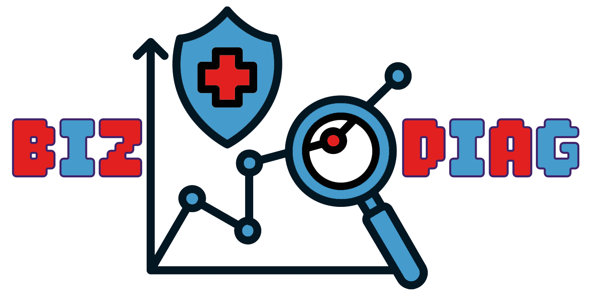

# BizDiag
## Intelligent Enterprise Architecture & Digital Strategy Automation

<p align="center">
  
</p>

BizDiag™ is an open-source software suite that transforms ArchiMate® models into structured, analyzable data to support 
Enterprise Architecture (EA) intelligence, Business–IT alignment analysis, and Business Model Canvas (BMC) synthesis and 
visualization. BizDiag™ is composed of modules that perform Enterprise Architecture automation, architecture 
intelligence, Business–IT alignment analysis, business model analysis, EA client/server application architecture 
blueprints, and digital strategy support.
BizDiag™ is the open-source core of the open-core "BizDiag Industry Intelligence™". “BizDiag Industry 
Intelligence™” is an umbrella product with high-end EA applications for specific industries, e.g., “BizDiag Tourism 
Intelligence™”, “BizDiag Manufacturing Intelligence™”, and “BizDiag Banking Intelligence™”.

BizDiag™ extracts data from EA models, and transforms ArchiMate® models into structured, analyzable data that can be 
queried, transformed, enriched with AI, and used to support architecture analysis and strategic decision-making.

A central principle of BizDiag™ is to make Enterprise Architecture information programmable. This makes it possible to
develop reusable automation around Enterprise Architecture models. Built around ArchiMate®, Archi, jArchi, GraalVM®, 
GraalJS®, Java®, JavaScript®, databases, and AI integration, BizDiag brings software automation into the Enterprise 
Architecture workflow. An Enterprise Architecture model should not merely describe an organization. It should be usable 
as structured data for analysis, automation, decision support, and strategy.

---

## **Overview**

Enterprise Architecture models often contain a significant amount of valuable organizational knowledge, but that 
information can remain difficult to analyze systematically.

BizDiag addresses this by treating the architecture model as structured data rather than only as a visual diagram. 
Automated analysis identifies suspicious structures, while architects and stakeholders determine their actual 
significance and appropriate remedies. This briefly states BizDiag's philosophy and the importance of the "human in the
loop" maxim.

The general workflow is:

```text
ArchiMate Model
        │
        ▼
      BizDiag
        │
        ├── Business–IT Alignment Analysis
        ├── DB Log
        ├── Generate Documentation
        ├── GraalJS TimeServer
        ├── Business Model Canvas
        ├── GraalJS NIOLoggerServer
        ├── GraalJS REST Logger
        ├── Java DBLogger Server
        │
        ▼
Architecture Intelligence
        │
        ▼
Strategic & Operational Insights
```

BizDiag is designed as a modular suite. Individual capabilities can be used independently, while multiple components can 
be combined to create organization-specific Enterprise Architecture workflows.

---

## Key Capabilities


### 1. **Business_IT_Alignment**: A Business–IT Alignment/Misalignment Analysis

BizDiag's Business_IT_Alignment subsystem includes analysis capabilities intended to help architects investigate
relationships between business and IT architecture.

The analysis can identify structural conditions that may indicate potential Business–IT alignment issues.

Detected conditions can be classified according to configurable severity levels such as:

- Low
- Medium
- High
- Critical

These classifications should be interpreted as analytical indicators rather than automatic business judgments.

BizDiag does not claim that an automatically detected condition is necessarily a business problem. Its purpose is to 
identify conditions that architects and decision-makers can investigate further.

This approach can help architecture teams systematically examine areas such as:

- Business capabilities and supporting applications
- Business services and application services
- Application dependencies
- Technology dependencies
- Missing or weak architectural relationships
- Potentially unsupported business structures


### 2. **DB_Log**: A Database Logging Component

DB_Log can transform architecture information into structured data suitable for programmatic analysis. Architecture 
data can be loaded into an in-memory database, like the utilized H2 database, or any other relational database systems, 
and queried using SQL, in a Java Swing GUI.

Moreover, the H2ConsoleLauncher.java runs the H2 database and opens the H2 console in a web browser, receiving the set
credentials, allowing users to query the architecture data using SQL, through a web interface.

The high-level structure of the DB_Log workflow is as follows:

```text
ArchiMate Model
        │
        ▼
Architecture Data Extraction
        │
        ▼
Structured Data
        │
        ▼
H2 Database / Java GUI
        │
        ▼
SQL Analysis
        │
        ▼
Enterprise Architecture Insights
```

This makes it possible to apply familiar data-analysis techniques to Enterprise Architecture information.

Potential applications include:

- Dependency analysis
- Element inventories
- Relationship analysis
- Architecture metrics
- Custom queries
- Data validation
- Automated reporting
- Organization-specific analytical models


### 3. **BizDiag Local AI**: An AI REST API for Smart Enterprise Architecture Operations

The BizDiag Local AI subsystem follows a layered, microservice-inspired architecture that separates Enterprise 
Architecture model interaction from AI inference. It is organized around two core capabilities:

- an AI-enhanced ArchiMate Application View to UML transformation script
- an AI-driven DocMaker subsystem for generating documentation

```
├── DocMaker Subsystem
│   ├── AI_Element_DocMaker_EN.ajs
│   ├── AI_Element_DocMaker_FA.ajs
│   ├── AI_View_DocMaker_EN.ajs
│   ├── AI_View_DocMaker_FA.ajs
│   ├── AI_REST_JSON.js
│   ├── Ollama_Olalla.ajs
│   ├── Mark_it_Down.ajs
│   └── AI_REST_JSON_Netty.js (if you keep it)
│
└── UML Subsystem
    ├── Application_View_to_UML.ajs
    └── sendToAI.js
```

1- **UML Subsystem**
The first BizDiag Local AI capability is `Application_View_to_UML.ajs`, a jArchi script that transformed the selected 
application-layer views into new views using UML-like notation instead of ArchiMate notation. It is an AI-enhanced 
UML-like view  generation script designed for architectural transformation and semantic enrichment. The script does not 
generate idiomatic UML, but instead it generates a UML-inspired component-diagram view from the selected ArchiMate 
Application View.

Application_View_to_UML.ajs 
converts the currently selected ArchiMate view into a new UML-style view displayed directly in Archi’s Models panel. The
latest version of this script uses Ollama through `sendToAI.js` to semantically analyze each element and generate more 
informed UML stereotypes and enriched documentation. It reads a user-selected source view—typically a Phase C - 
Information Systems Architecture view—extracts application-layer concepts and relationships, and creates a new Archi 
view using UML-style diagram notation enhanced with AI-generated semantic classifications.

2- **DocMaker Subsystem**
This application consists of `AI_View_DocMaker_EN.ajs`, `AI_Element_DocMaker_FA.ajs`, `AI_Element_DocMaker_EN.ajs`,
`AI_Element_DocMaker_FA.ajs`, `AI_REST_JSON.js`, `Ollama_Olalla.ajs`, and `Mark_it_Down.ajs`.
The DocMaker subsystem within BizDiag Local AI is organized into three principal layers. First, the jArchi layer 
operates inside Archi and consists of bilingual documentation scripts—`AI_Element_DocMaker_EN.ajs` / 
`AI_Element_DocMaker_FA.ajs` and `AI_View_DocMaker_EN.ajs` / `AI_View_DocMaker_FA.ajs`—which extract ArchiMate element 
and view metadata in response to user selection and coordinate processing through Ollama_Olalla.ajs. Second, 
the communication abstraction layer, implemented in pure JavaScript through `AI_REST_JSON.js`, serializes enterprise 
architecture data to JSON payloads, manages HTTP POST requests to a local Ollama endpoint, saves AI-generated responses 
to persistent JSON documentation files, and tracks element context (element ID, name, type, view name, and timestamps).   
This design decouples model extraction from AI inference and supports loose coupling between the two functions. Third,   
the Ollama runtime executes outside Archi on the user's local machine, hosting LLMs that process documentation requests  
without cloud dependencies, external API keys, or exposure of sensitive architecture data to remote services.
Post-processing is performed by `Mark_it_Down.ajs`, which formats AI-generated output as structured Markdown and uses 
Java NIO.2 APIs for reliable file-system operations. Overall, this architecture emphasizes data privacy, reduced 
operational cost, offline functionality, and extensibility, allowing organizations to replace underlying LLMs, add 
language variants, or integrate alternative AI runtimes without modifying the core enterprise architecture extraction 
logic.

_Why Ollama?_

Ollama was chosen as the local AI runtime instead of requiring a cloud-based AI service and an external API key. As a 
Digital Business Practitioner, I wanted AI-assisted documentation to provide greater control over potentially sensitive 
Enterprise Architecture information and reduce dependency on external services.

Other considerations, including operational cost, performance, local execution, and the ability to work without an 
Internet connection, also motivated the development of an offline documentation generator. The project builds upon the 
broader concept of AI-assisted ArchiMate documentation generation, while providing a distinct local-AI implementation 
based on Ollama.

_The Scripts_

AI-assisted capabilities can be used to support tasks such as:

- Architecture documentation
- Element description generation
- Architecture information enrichment
- Analysis assistance
- Natural-language interaction with architecture information
- Generation of structured architecture-related content
- Leveraging locally-installed Ollama, together with local AI Models

The architecture workflow supports offline AI models. BizDiag_Local_AI uses Java NIO.2 for robust filesystem and 
directory management. The following are the jArchi scripts and JavaScript files of this application:

| Script                       | Description                                                                                                                                                                                            |
|------------------------------|--------------------------------------------------------------------------------------------------------------------------------------------------------------------------------------------------------|
| `AI_Element_DocMaker_EN.ajs` | Generates AI analysis for the selected element in Archi, in English                                                                                                                                    |
| `AI_Element_DocMaker_FA.ajs` | Generates AI analysis for the selected element in Archi, in Persian                                                                                                                                    |
| `AI_View_DocMaker_EN.ajs`    | Generates AI analysis for the selected view in Archi, in English                                                                                                                                       |
| `AI_View_DocMaker_FA.ajs`    | Generates AI analysis for the selected view in Archi, in Persian                                                                                                                                       |
| `AI_REST_JSON.js`            | Provides REST API communication with Ollama, handles JSON serialization/deserialization, manages element context tracking, and persists AI-generated documentation to files (used by DocMaker scripts) |
| `Mark_it_Down.ajs`           | Provides Markdown export functionality for selected Archi views and elements                                                                                                                           |
| `Ollama_Olalla.ajs`          | Provides integration with the locally installed Ollama AI runtime                                                                                                                                      |
| `sendToAI.js`                | Simple HTTP client wrapper for querying Ollama (used by Application_View_to_UML.ajs only; independent of AI_REST_JSON.js)                                                                              |

This allows organizations to select an AI deployment approach appropriate to their technical and information-security 
requirements.


```
================================================================================
        `BizDiag_Local_AI`: High-Level Architectural Overview
================================================================================
```
```
┌─────────────────────────────────────────────────────────────────────────────┐
│                          ARCHI (jArchi Environment)                         │
│                                                                             │
│   ┌──────────────────────────────────────────────────────────────────┐      │
│   │              User: Select Element or View in Archi               │      │
│   └────────────────────┬─────────────────────────────────────────────┘      │
│                        │                                                    │
│        ┌───────────────┴───────────────┐────────────────────────┐           │
│        │                               │                        │           │
│        ▼                               ▼                        ▼           │
│   ┌─────────────────┐         ┌──────────────────┐     ┌──────────────────┐ │
│   │ Element DocMaker│         │ View DocMaker    │     │Application_View_ │ │
│   │                 │         │                  │     │to_UML.ajs        │ │
│   │ EN.ajs / FA.ajs │         │ EN.ajs / FA.ajs  │     │                  │ │
│   │                 │         │                  │     │  (Selected       │ │
│   │ (jArchi Scripts │         │ (jArchi Scripts) │     │ Application  View│ │
│   │  in Archi)      │         │ in Archi)        │     │                  │ │
│   └────────┬────────┘         └────────┬─────────┘     └────────┬─────────┘ │
│            │                           │                        │           │
│            └───────────────┬───────────┘                        │           │
│                            │                                    │           │
│                            ▼                                    │           │
│                   ┌─────────────────┐                           │           │
│                   │ Ollama_Olalla   │                           │           │
│                   │ .ajs            │                           │           │
│                   │                 │                           │           │
│                   │ Local AI        │                           │           │
│                   │ Integration     │                           │           │
│                   └────────┬────────┘                           │           │
│                            │                                    │           │
└────────────────────────────┼────────────────────────────────────│───────────┘
                             │
                             ▼
┌────────────────────────────────────────────┐
│     AI_REST_JSON.js                        │
│                                            │
│  REST API Communication Layer              │
│  JSON Payload Preparation & Parsing        │
│  Element Context Tracking & Persistence    │
│  Retry Logic with Timeout Handling         │
│  File I/O for Documentation Storage        │
└────────────────────┬───────────────────────┘
                     │
            (DocMaker scripts route here)
                     │
                     ▼
         Ollama Endpoint at localhost:11434
                     │
                     │ HTTP Request
                     │ (JSON Payload)
                     ▼
┌────────────────────────────────────────────┐
│    OLLAMA (Local AI Runtime)               │
│                                            │
│  ┌──────────────────────────────────────┐  │
│  │  Local AI Model (e.g., Llama2,       │  │
│  │  Mistral, Neural Chat, etc.)         │  │
│  │                                      │  │
│  │  Generate Documentation:             │  │
│  │  - Element descriptions              │  │
│  │  - View analysis                     │  │
│  │  - Architecture rationale            │  │
│  └──────────────────────────────────────┘  │
└────────────────────┬───────────────────────┘
                     │
                     │ HTTP Response
                     │ (AI-Generated Content)
                     ▼
┌────────────────────────────────────────────────┐
│  AI_REST_JSON.js (Response Handler)            │
│                                                │
│  Parse Response JSON                           │
│  Extract AI Output                             │
│  Save to documentation/{viewName}/json file    │
│  Track element metadata & timestamp            │
└────────────────────┬───────────────────────────┘
                     │
                     ▼
┌────────────────────────────────────────────────────────────────────────────┐
│  ARCHI (jArchi Environment) - Post-Processing                              │
│                                                                            │
│           ┌──────────────────────────────────────────────┐                 │
│           │   Mark_it_Down.ajs                           │                 │
│           │                                              │                 │
│           │   Markdown Export & Formatting               │                 │
│           │   - Format AI output as Markdown             │                 │
│           │   - Structure documentation                  │                 │
│           │   - Add metadata/headers                     │                 │
│           └────────────────┬─────────────────────────────┘                 │
│                            │                                               │
│                            ▼                                               │
│           ┌──────────────────────────────────────────────┐                 │
│           │   Java NIO.2 File System Operations          │                 │
│           │                                              │                 │
│           │   - Directory Management                     │                 │
│           │   - File I/O Operations                      │                 │
│           │   - Robust Path Handling                     │                 │
│           └────────────────┬─────────────────────────────┘                 │
│                            │                                               │
│                            ▼                                               │
│           ┌──────────────────────────────────────────────┐                 │
│           │   documentation/ (Output Folder)             │                 │
│           │                                              │                 │
│           │   ├── element_<name>.md                      │                 │
│           │   ├── view_<name>.md                         │                 │
│           │   └── [AI-Generated Markdown Files]          │                 │
│           └──────────────────────────────────────────────┘                 │
│                                                                            │
└────────────────────────────────────────────────────────────────────────────┘
```
```
================================================================================
                                DATA FLOW SUMMARY
================================================================================
```
```
User Input
│
├─→ Selects Element/View in Archi
│
├─→ Triggers DocMaker Script (EN/FA variant)
│
├─→ Extracts Element/View Metadata
│
├─→ Calls AI_REST_JSON.js with (prompt, element, isReplacement)
│
├─→ AI_REST_JSON.js Prepares JSON Payload
│
├─→ AI_REST_JSON.js Sends HTTP Request to Ollama
│
├─→ Ollama Processes with Local LLM
│
├─→ Ollama Returns AI-Generated Documentation (HTTP Response)
│
├─→ AI_REST_JSON.js Parses Response & Persists to documentation/ folder
│
├─→ AI_REST_JSON.js Tracks element context (ID, name, type, timestamp)
│
├─→ Formats as Markdown (Mark_it_Down.ajs) — optional post-processing
│
└─→ Documentation stored in documentation/{viewName}/ai_documentation.json
```
```
================================================================================
                         COMPONENT RESPONSIBILITIES
================================================================================
```
```
┌─────────────────────────────────────────────────────────────────────────────┐
│ jArchi Scripts (Run Inside Archi)                                           │
├─────────────────────────────────────────────────────────────────────────────┤
│                                                                             │
│ AI_Element_DocMaker_EN.ajs / FA.ajs                                         │
│   • Triggered when user selects an ArchiMate element                        │
│   • Extracts element name, type, description, relationships                 │
│   • Calls Ollama_Olalla to initiate AI processing                           │
│   • Returns formatted result to user                                        │
│   • Supports English (EN) and Persian (FA) output                           │
│                                                                             │
│ AI_View_DocMaker_EN.ajs / FA.ajs                                            │
│   • Triggered when user selects an ArchiMate view                           │
│   • Extracts view structure, contained elements, relationships              │
│   • Prepares comprehensive view metadata                                    │
│   • Calls Ollama_Olalla for AI analysis                                     │
│   • Supports English (EN) and Persian (FA) output                           │
│                                                                             │
│ Ollama_Olalla.ajs                                                           │
│   • Orchestrates communication with Ollama                                  │
│   • Manages request lifecycle                                               │
│   • Handles callbacks and error conditions                                  │
│   • Routes DocMaker requests through AI_REST_JSON.js layer                  │
│                                                                             │
│ Mark_it_Down.ajs                                                            │
│   • Formats AI-generated text into structured Markdown                      │
│   • Adds metadata headers (element type, date, author)                      │
│   • Creates proper file structure                                           │
│   • Handles language-specific formatting                                    │
│                                                                             │
└─────────────────────────────────────────────────────────────────────────────┘

┌─────────────────────────────────────────────────────────────────────────────┐
│ JavaScript Libraries (Communication & Utility)                              │
├─────────────────────────────────────────────────────────────────────────────┤
│                                                                             │
│ AI_REST_JSON.js                                                             │
│   • Serializes EA data to JSON (conforming to request payload format)       │
│   • Establishes HTTP connection to Ollama and sends POST requests           │
│   • Handles timeouts and retry logic with configurable retry attempts       │
│   • Deserializes Ollama responses from JSON                                 │
│   • Persists AI-generated documentation to JSON files via Java NIO.2        │
│   • Tracks element context (ID, name, type, view name, timestamps)         │
│   • Bridges jArchi data structures ↔ REST API contract                      │
│   • Used by: AI_Element_DocMaker_EN/FA.ajs, AI_View_DocMaker_EN/FA.ajs      │
│                                                                             │
│ sendToAI.js                                                                 │
│   • Simple HTTP client wrapper for querying Ollama                          │
│   • Establishes HTTP connection to localhost Ollama endpoint                │
│   • Constructs HTTP POST requests with JSON body                            │
│   • Returns response text only (no context tracking or file I/O)            │
│   • Used by: Application_View_to_UML.ajs only                               │
│   • INDEPENDENT from AI_REST_JSON.js (different codebases)                  │
│                                                                             │
└─────────────────────────────────────────────────────────────────────────────┘

┌─────────────────────────────────────────────────────────────────────────────┐
│ External Runtime (Local Machine)                                            │
├─────────────────────────────────────────────────────────────────────────────┤
│                                                                             │
│ Ollama                                                                      │
│   • Runs locally on the user's machine (e.g., localhost:11434)              │
│   • No cloud dependency, no API keys, no external service calls             │
│   • Hosts one or more AI models (configurable by user)                      │
│   • Exposes REST API endpoint: POST /v1/chat/completions (or similar)       │
│   • Processes each request in context window                                │
│   • Returns model-generated text in JSON response                           │
│                                                                             │
└─────────────────────────────────────────────────────────────────────────────┘
```
```
================================================================================
                     KEY ARCHITECTURAL CHARACTERISTICS
================================================================================
```
1. LOCALIZATION & OFFLINE OPERATION
   ✓ All AI processing occurs on user's local machine via Ollama
   ✓ No cloud API calls, no external service dependencies
   ✓ Full control over sensitive EA data
   ✓ Works without Internet connection

2. MULTI-LANGUAGE SUPPORT
   ✓ Bilingual scripts: English (EN) and Persian (FA) variants
   ✓ Documentation output respects language choice
   ✓ Extensible to additional languages

3. MODULARITY
   ✓ Each component has clear responsibility
   ✓ Loosely coupled via JSON/REST contracts
   ✓ Can be extended or replaced independently
   ✓ Supports different Ollama models

4. SEPARATION OF CONCERNS
   ✓ jArchi scripts handle EA model interaction (inside Archi)
   ✓ JavaScript libraries handle REST/JSON communication
   ✓ Ollama handles AI inference (external runtime)
   ✓ File system I/O via Java NIO.2 (robust and async-ready)

5. WORKFLOW INTEGRATION
   ✓ Seamlessly integrated into Archi UI (native jArchi)
   ✓ Output automatically saved to project folder
   ✓ Can chain with other BizDiag components
   ✓ Results exportable for further processing

```
================================================================================
                       TYPICAL INTERACTION SEQUENCE
================================================================================
```
```
User in Archi
│
├─ Right-click on Business Service "Customer Portal"
│
├─ Select "AI_Element_DocMaker_EN" from Scripts menu
│
├─→ ElementDocMaker extracts: { name, type, description, relationships }
│
├─→ ElementDocMaker calls AI_REST_JSON with (prompt, element, isReplacement)
│
├─→ AI_REST_JSON serializes to JSON
│
├─→ AI_REST_JSON posts to http://localhost:11434/api/generate
│
├─→ Ollama LLM processes: "Describe this ArchiMate Business Service..."
│
├─→ Ollama returns: JSON with generated documentation text
│
├─→ AI_REST_JSON receives response and deserializes JSON
│
├─→ AI_REST_JSON saves to: documentation/business-service-customer-portal/ai_documentation.json
│
├─→ AI_REST_JSON tracks: { elementId, elementName, elementType, timestamp, content, viewName }
│
├─→ Mark_it_Down formats as Markdown with headers/metadata (optional post-processing)
│
└─ User sees success message in Archi console
```
Result: documentation/business-service-customer-portal.md
- Professional markdown documentation
- AI-generated content
- Ready for sharing / publication


### 4. **GraalJS_ClientServer_Template**: A GraalJS ClientServer Blueprint

This is a client and server template for Archi. The client is a jArchi script, native to Archi environment, while the 
server is a GraalJS application, with JavaScript outer structure, and Java inner structure. As a template application
this is a time-server/time-client application. This provides a unique architecture,while both client and server are 
written in GraalJS, the clientside code is a jArchi dialect of GraalJS, while the serverside code is pure original 
GraalJS. 

The server code could be well written in vanilla Java, however there was a good reason behind this decision. This 
intentional design was chosen for demonstrating how to write both jArchi code and non-jArchi code, both in GraalJS; and 
how to utilize different dialects of GraalJS runtime environment in one codebase. This is particularly very useful in 
projects that mandate uniformly coding in one particular language.


### 5. **BizModelCanvas**: A Business Model Canvas Generation & Analysis 

As a module of BizDiag software package, BizModelCanvas collection is a toolkit for analyzing value propositions, 
producing enhanced views, and converting Business Model Canvas layouts into ArchiMate views. It is built to run inside 
Archi using the jArchi (GraalJS) environment and includes two GUI launchers (BizModelCanvas-GUI-EN.ajs and 
BizModelCanvas-GUI-FA.ajs) which serve as the GUI for accessing and executing a set of helper/analysis scripts in the 
scripts/ folder. The scripts in this script-suite are the result of deeply researching the field of digital business 
model, and applying the findings of the conducted research on these scripts. These scripts perform a wide range of 
operations on the BMC, namely, they analyze models for all the nine building blocks of their business model canvas.

BizDiag now has a fully functional, bilingual, unified GUI system for managing nine BizModelCanvas jArchi scripts. This
system provides professional access to enterprise architecture analysis tools with full English and Persian language 
support.

For using the GUI, launch either BizModelCanvas GUI script from Archi’s Scripts Manager. The GUI attempts to locate the 
suite automatically.

The BizModelCanvas-GUI-EN and BizModelCanvas-GUI-FA scripts provide access to the functionality of the nine Business 
Model Canvas through a three-tabbed dialog box.

1. The first tab, 'Analysis', lets the user analyze the model for value propositions, clean up value propositions,  
detect duplicate value propositions, and diagnose the value proposition structure.

2. The second tab, 'Creating Views', allows the user to create a view with enhanced value proposition and also convert  
the BMC to ArchiMate notation. This tab has two buttons, `scripts/Create Enhanced Value View`, and 
`scripts/convertBMCtoArchiMate`. The former script/button creates an enhanced 'Value Proposition View', in Models Panel 
in Archi, completely in the ArchiMate notation, while the second script/button performs elements discovery, relationship 
analysis, value proposition view creation, and populating the new created view with the new enhanced ArchiMate-notation 
value proposition view. This script, 'convertBMCtoArchiMate.ajs',is the meat of this script-suite. It finds BMC canvas 
within the current ArchiMate model; extracts its nine building blocks; Finds the BMC cells' connections in the extant 
BMC canvas, converts them to semantic ArchiMate notation, and finally, creates a new view in ArchiMate notation, 
utilizing Business Model Canvas Detector (`lib/bmcDetector.ajs`), and Business Model Canvas Generator 
(`lib/bmcGenerator.ajs`) scripts.

3. The third tab, 'Testing', provides tools for debugging the view and model, providing deep model intelligence, as well
as testing relationship types. When available, the Business Model Canvas (BMC) is commonly located within the  
Architecture Vision (TOGAF Phase A) section of an EA repository, although many models may not contain a BMC artifact. 
BMC can be used as an input for analytical and transformation workflows, for the BizModelCanvas script-suite.

4. The fourth tab, called BMC Generation, does only one thing through the scripts/Draw BMC Graphic.ajs, which is to draw
a high resolution BMC graphic in a new shell, while saving a copy in PNG format, in the %TEMP% directory of your 
operating system, based on the existing BMC elements in the model. Unlike the second tab (Creating View), which creates 
view within the ArchiMate model, this script/button does not create a new view in the model. I refrained from creating a 
view and embedding the BMC in it, for two reasons. First, some ArchiMate models already include a BMC view, and this new 
view could be deemed as duplication. The stakeholders expect to have one unique BMC as the source of truth. 
Second, the script-generated BMC needs human supervision and modification, in any case, as BMC is a delicate high-level 
business artifact whose importance could be far beyond than anything else in the organization, and hence an 
auto-generated once could not be trusted without human supervision. Therefore, as the author of this script, I strongly 
believe that the auto-generated BMC should only be used as a draft, or a hint, for drawing the final BMC.

In the `scripts` folder, the following 11 key jArchi scripts live: 

```text
        1├── Analyze Model for Value Proposition.ajs
        2├── Cleanup Value Propositions.ajs
        3├── convertBMCtoArchiMate.ajs
        4├── Create Enhanced Value View.ajs
        5├── Debug View and Model.ajs
        6├── Deep Model Intelligence.ajs
        7├── Detect Duplicate Value Propositions.ajs
        8├── Diagnose Value Proposition Structure.ajs
     	9├── Test Relationship Types.ajs
       10├── Draw BMC Graphic.ajs
       11├── Generate BMC from Model.ajs    	
```
Save for the 'Draw BMC Graphic.ajs', which draws Business Model Canvas Graphic, for 'BizModelCanvas-GUI-EN.ajs' and 
'BizModelCanvas-GUI-FA.ajs', the other ten scripts are each accessible either directly, or through the four tabs of
BizModelCanvas-GUI-EN and BizModelCanvas-GUI-FA scripts. 

Apart from the deep analysis, finding BMC errors, debugging and cleaning up the model, checking for the existence of any
critical definition gaps, and providing the business analysts with the precious business model metrics, this BMC 
script-suite is equipped with two operational scripts, videlicet, 'Create Enhanced Value View.ajs', and 
'convertBMCtoArchiMate.ajs'.

This helps connect business model thinking with Enterprise Architecture modeling, enabling stakeholders to read and 
process the BMC in the ArchiMate view, and hence relating to the model as a whole. Besides, mapping BMC to ArchiMate 
architectural view representation can help organizations to analyze the business model in the context of the overall 
architecture, and hence to identify potential gaps, misalignments, or opportunities for improvement. Moreover, a wide 
variety of new views, e.g., 'Core Capability View', 'Customer Interaction View', and 'Value Proposition View', in 
ArchiMate notation, will be derived from the BMC input.

There are three omnipresent traits, constructing business model foundation, on almost each and every definition of
business model:

| Trait                 | Description                                                                           |
|-----------------------|---------------------------------------------------------------------------------------|
| **Value Proposition** | What value the business promises to deliver to its customers.                         |
| **Value Creation**    | How the business creates and delivers that value.                                     |
| **Value Proposition** | How the business converts the delivered value into revenue or other economic returns. |

Therefore, I decided to factor in the aforementioned attributes to BizModelCanvas scripts, and these concepts should be
reflected in the future developments of BizModelCanvas script-suite.

Occasionally, you also have to tend your ArchiMate model and its evolutions over time, and be mindful of the very fact
that business model is not a static entity, and it changes throughout your organization lifetime. As a result, you have
to mend your business model canvas, periodically, and run this script suite against your model to see if the model
changes lead to a different BMC. After all, if you take care of your business model, your business model will take care 
of you!

### 6. **GraalJS_NIOLoggerServer**: A Client/Server/Dumper in (GraalJS: jArchi dialect)/(GraalJS: vanilla GraalJS)/(JavaScript)

This module of BizDiag supports exporting element information into formats suitable for further analysis and integration.
`GraalJS_NIOLoggerServer` has a click-dumper client, `nio_interop_client.js`, which receives click events on elements in
the Archi environment, dumping them, simultaneously, to both an H2 and a JSONL file. User can access those 
locally-dumped element-data through the H2 database, or through the JSONL file. The JSONL file can be used for further 
processing, including potential AI-assisted analysis, or integration with any external tools.

The application is leveraging client/server architecture. `GraalJS NIO Server` runs a pure NIO Selector loop on the main 
thread. All connections are handled in a non-blocking fashion. Logging (JDBC/File I/O) is executed synchronously within 
the event loop, accepting that these operations are blocking and will momentarily pause the loop. Therefore, the server 
is a plain .js file, living outside Archi/jArchi.

JSONL export can be particularly useful for:

- AI pipelines
- Data processing
- Machine learning workflows
- Large-scale architecture analysis
- Integration with external tools
- Marketing department

Spreadsheet-based exports can support:

- Architecture reviews
- Reporting
- Data inspection
- Stakeholder analysis
- Further processing using common business tools

Briefly, the architecture of thus subsystem could be summarized like this:

`log_click.ajs` dumps → `nio_interop_client.js` → `nio_interop_server.js` → [H2 + JSONL] for analytics.


### 7. **GraalJS_ClientServer_Template**: A Client/Server in (GraalJS: jArchi dialect)/(GraalJS: vanilla GraalJS)

This is a GraalJS-based REST server that receives HTTP requests, in form of clicking an element, from the jArchi 
environment, and subsequently logs them to both an H2 and a JSONL file. The REST server can be used to log chosen 
element's information. For running this, you should first run the server outside Archi. Then, click the ArchiMate 
element you are interested in. Now, stop the server. Your element is dumped in an H2 database record and in a JSONL file.
Please note that you only need to interact with The nio_interop_server.js, which is a plain .js file, living outside 
Archi/jArchi, and the log_click.ajs, which is a jArchi script, living inside Archi/jArchi. The rest of the files are 
just libraries, and you don't need to interact with them directly. The server is a GraalJS application, with JavaScript 
outer structure, and Java inner structure. As a template application this is a REST server application. This provides a 
clean architecture, while both client and server are written both in GraalJS, the clientside code is the jArchi dialect 
of GraalJS, while the serverside code is vanilla GraalJS. 

The H2 record and JSONL file can be used for further processing, including AI-assisted analysis, or integration with 
external tools. 


### 8. Java DBLoggerServer

The functionality of Java_DBLoggerServer is similar to GraalJS_Element_RESTLogger. NioInteropServer.java runs as a 
standalone Java server, outside Archi. While running, it receives HTTP requests from the jArchi environment, in form of 
clicking ay Archi element of choice, storing its data in a JSONL file and in an H2 database simultaneously.

While having the same functionality as GraalJS_Element_RESTLogger, the Java_DBLoggerServer is a pure Java application. 
This kind of application is sometimes preferred, as The server can validate the incoming JSONL payload, sanitize user 
inputs, apply security rules, and authenticate the client before writing anything to a shared corporate database or log. 
Besides, The jArchi client doesn't need to know how the data is saved (database, cloud, file); it just sends a packet to 
a known endpoint. The server can accept bursts of client data, queue it up, and write it to the log/database in a slower,
managed batch process, preventing resource lock issues.


---

## Why ArchiMate & jArchi?

BizDiag is built around the ArchiMate modeling language and the Archi modeling tool, with jArchi providing scripting 
capabilities. This combination provides a practical foundation for architecture automation:

- ArchiMate provides a structured architecture language.
- Archi provides a practical modeling environment.
- jArchi exposes the architecture model programmatically.
- Java and JavaScript provide application and automation capabilities.
- Databases provide structured data analysis.
- AI can provide additional analysis and documentation capabilities.

The result is an architecture environment where models can become more than static documentation.

---

## Technology Stack

| Technology   | Role                                                                                                    |
|--------------|---------------------------------------------------------------------------------------------------------|
| Archi        | Enterprise Architecture modeling environment                                                            |
| ArchiMate    | Enterprise Architecture modeling language                                                               |
| jArchi       | Architecture model scripting plugin for Archi                                                           |
| Java         | Standalone application development                                                                      |
| JavaScript   | Both as outer structure of jArchi scripts and as standard .js JavaScript code, used in helper files.    |
| GraalJS      | JavaScript language implementation, used in 2 flavors: jArchi scripts & standalone GraalJS applications |
| JDBC         | Java Database Connectivity                                                                              |
| H2           | Lightweight database and in-memory analysis                                                             |
| JSON / JSONL | Structured architecture data                                                                            |
| XML          | Utilized in pom.xml for Apache Maven projects' build and configuration information                      |
| CSV / Excel  | Data export and storage for later analysis                                                              |
| AI Models    | AI-assisted analysis and documentation                                                                  |
| Ollama       | Local AI model management and execution                                                                 |


---

## Data Flow

A typical BizDiag workflow can be represented as:

```text
                 +----------------------+
                 |   ArchiMate Model    |
                 +----------+-----------+
                            │
                            ▼
                 +----------------------+
                 |    BizDiag Engine    |
                 +----------+-----------+
                            │
              +-------------+-------------+
              │                           │
              ▼                           ▼
     +------------------+      +----------------------+
     | Architecture     |      | AI Analysis          |
     | Analysis         |      |                      |
     +------------------+      +----------------------+
              │
              ▼
     +----------------------+
     | Transformation &      |
     | Export                |
     +----------+-----------+
                │
                ▼
     +----------------------+
     | Architecture         |
     | Intelligence         |
     +----------+-----------+
                │
                ▼
     +----------------------+
     | Strategic /          |
     | Operational          |
     | Decision Support     |
     +----------------------+
```

---

## Modular Architecture

BizDiag is not intended to be a single monolithic application.

The project consists of multiple components, including:

- Business–IT Alignment Analysis
- DB Log
- Generate Documentation
- GraalJS TimeServer
- Business Model Canvas
- GraalJS NIOLoggerServer
- GraalJS REST Logger
- Java DBLogger Server

Individual components can be used independently.

Organizations can also combine or extend components to create architecture workflows tailored to their own environment.

---

## Extensibility

BizDiag is designed to be extended.

Potential extension areas include:

- New architecture analyses
- Custom business rules
- New data-export formats
- Additional AI providers
- Custom SQL analysis
- Organization-specific architecture metrics
- Custom reporting
- Integration with external systems
- Custom transformation pipelines
- Client/server architectures
- Bespoke Enterprise Architecture automation

The source code is available so that architects, developers, researchers, and organizations can inspect, adapt, and 
extend the implementation according to the terms of the license.

---

## Client / Server Capabilities

BizDiag components can be used in different deployment scenarios, including:

- Local desktop workflows
- Architecture-team environments
- Client-side tools
- Server-side applications
- Database-backed environments
- Hybrid architecture automation workflows

Deployment architecture depends on the specific BizDiag component and its intended use.

---

## Intended Users

BizDiag is intended for people and organizations working with Enterprise Architecture and related disciplines, including:

- Strategy firms
- Business Architects
- Enterprise Architects
- IT Solution Companies
- Business Model Analysts
- Digital business analysts
- Architecture governance teams
- Enterprise Architecture consultants
- Digital Transformation practitioners
- Enterprise Architecture researchers and academics
- Software developers working with software architecture models
- 'Information Technology', 'Computer Science', and 'Software Engineering' Students

---

## Example Use Cases

BizDiag can support use cases such as:

- Business–IT Alignment
- Architecture Reporting
- AI-Assisted Documentation
- Architecture Data Analysis
- Custom Architecture Automation
- Business Model to Architecture
- Enterprise Architecture Assessment

---

### Enterprise Architecture Assessment
Analyze an existing ArchiMate model and identify structural conditions that warrant further architectural investigation.

---

### Business–IT Alignment
Examine relationships between business and IT architecture and identify potentially unsupported or weakly connected areas.

---

### Architecture Data Analysis
Extract architecture information and perform custom SQL-based analysis.

---

### AI-Assisted Documentation
Use AI models to assist with architecture descriptions and documentation.

---

### Business Model to Architecture
Analyze a Business Model Canvas and transform relevant business information into an ArchiMate-oriented representation.

---

### Architecture Reporting
Export architecture information into JSONL, CSV, Excel, or other formats for reporting and downstream processing.

---

### Custom Architecture Automation
Build organization-specific scripts and applications around an existing ArchiMate repository.

---

## Installation

BizDiag consists of multiple components, and installation depends on the specific component being used.

Typical requirements may include:

- Archi (5.8 or later)
- jArchi plugin (1.11 or later)
- An ArchiMate or compatible XML EA model
- GraalVM (25 or later) for standalone Java applications
- Apache Maven for building standalone Java and GraalJS applications
- Ollama and any Optional locally-installed AI model

Detailed installation instructions for individual components are provided in their respective documentation. For 
command-line tools, a running.txt file is included in the repository to provide the commands for running the applications.

---

## Model Input

BizDiag architecture-analysis workflows operate on ArchiMate models created or maintained in Archi.

---

## Repository Structure

The repository is organized to separate reusable automation, applications, examples, and documentation.

```text
BizDiag/
├── README.md
├── LICENSE
├── NOTICE
├── CITATION.cff
├── applications/
│   ├── ...
│   └── ...
├── scripts/
│   ├── ...
│   └── ...
├── videos/
    ├── ...
    └── ...

```

The exact repository structure may evolve as the project grows.

---

## Open Source & Commercial Services

BizDiag is released as open-source software under the CeCILL-B Free Software License, a French-law software license 
developed by CEA, CNRS, and Inria.

The BizDiag source code is made available for inspection, use, modification, integration, and redistribution in 
accordance with the terms and conditions of the CeCILL-B license.

CeCILL-B grants broad freedom to reuse and redistribute the software, including within proprietary or commercial 
software, while imposing a strong obligation to preserve and acknowledge the authorship and licensing of the original 
software when it is incorporated into another work.

The open-source distribution of BizDiag is intended to provide:

- Transparency of the software and its implementation
- Freedom to inspect, use, modify, and redistribute the software
- Technical independence
- Reproducibility
- Extensibility and integration
- Community collaboration
- Reduced vendor lock-in

Professional services may be provided separately, including:

- Enterprise Architecture assessment
- Enterprise Architecture implementation
- Architecture automation
- BizDiag implementation
- Client/server deployment
- Integration with existing systems
- Organization-specific customization
- Bespoke and ad-hoc development
- Custom architecture analysis
- Training
- Technical consulting
- Enterprise Architecture consulting

Such services may be provided under separate commercial agreements defining their respective scope, deliverables, 
responsibilities, fees, support arrangements, intellectual-property provisions, and other applicable terms.

The open-source software and professional services are therefore complementary but legally distinct: BizDiag provides an
open and reusable technical foundation, while professional services may address organization-specific architecture, 
implementation, integration, development, training, and consulting requirements.

Nothing in the CeCILL-B license obliges the copyright holder or any contributor to provide technical assistance, 
maintenance, customization, implementation services, or other professional services for BizDiag.

---

## Design Principles

BizDiag is guided by several principles.

### Model as Data
Enterprise Architecture models should be usable as structured information, not only as visual diagrams.

### Automation First
Repetitive architecture activities should be candidates for automation.

### Open Architecture
Architecture tooling should support interoperability, extensibility, and integration.

### Practical Intelligence
Analysis should provide useful information that architects and decision-makers can investigate and apply.

### Human-in-the-Loop
Automated analysis and AI assistance should support architects rather than replace architectural judgment.

### Modular Design
Individual capabilities should be reusable independently and composable into larger workflows.

### Technology Independence
Organizations should be able to inspect and adapt the software rather than depend entirely on a closed implementation.

---

## Current Scope

BizDiag currently focuses on:

- Enterprise Architecture automation
- ArchiMate model analysis
- jArchi automation
- Business–IT alignment analysis
- Architecture data extraction
- SQL-based architecture analysis
- AI-assisted architecture documentation
- Business model analysis
- Business Model Canvas transformation
- Architecture data export
- Digital strategy support

The project is actively evolving, and capabilities may change as additional tools and applications are added.

---

## Roadmap

Potential future development areas include:

- Additional architecture analysis algorithms
- Advanced Business–IT alignment analysis
- Additional AI integrations
- Improved local AI support
- Architecture knowledge graphs
- Advanced architecture metrics
- Automated architecture reporting
- Additional business model transformations
- Additional database integrations
- Web-based architecture analysis
- Client/server architecture services
- Expanded API capabilities
- Additional visualization and dashboard capabilities
- Integration with other Enterprise Architecture tools

The roadmap is subject to change based on technical development and practical requirements.

---

## Contributing

Contributions, suggestions, issue reports, and technical discussions are welcome.

Potential contribution areas include:

- Bug fixes
- New jArchi scripts
- Java applications
- Architecture analysis algorithms
- Documentation
- Examples
- Integrations
- Data transformations
- AI integrations
- Testing
- Performance improvements

Before making substantial changes, please consider opening an issue to discuss the proposed approach.

---

BizDiag is released under the **CeCILL-B Free Software License**. If you incorporate BizDiag or portions of its source 
code into another software product or work, the applicable copyright, licensing, and attribution notices must be 
preserved in accordance with the terms of the CeCILL-B license.

For research, academic work, technical documentation, presentations, publications, or other works that make substantial 
use of BizDiag, citation of the project and its author is also requested as a matter of scholarly and professional 
attribution.

The repository includes a `CITATION.cff` file containing the preferred citation metadata. GitHub's “Cite this 
repository” functionality may also be used to obtain the repository's citation information.

### APA

Pak, E. (2026). BizDiag: Intelligent Enterprise Architecture & Digital Strategy Automation [Computer software]. GitHub.

### MLA

Pak, Ebrahim. BizDiag: Intelligent Enterprise Architecture & Digital Strategy Automation. 2026. GitHub.

### Chicago

Pak, Ebrahim. 2026. “BizDiag: Intelligent Enterprise Architecture & Digital Strategy Automation.” Software. GitHub.

The `CITATION.cff` file is the authoritative source for the project's citation metadata. If the citation information in 
this document differs from the current `CITATION.cff`, please use the information provided in `CITATION.cff`.

---

## License

Copyright © 2026 Ebrahim Pak

BizDiag is free software distributed under the CeCILL-B Free Software License, Version 1.0.

The CeCILL-B license grants broad rights to use, copy, modify, and redistribute the software, subject to the terms and 
conditions of the license, including its requirements concerning intellectual-property notices and attribution.

See LICENSE for the complete CeCILL-B license text.

The official CeCILL-B license and related information are maintained by the organizations that created the CeCILL 
family of licenses: CEA, CNRS, and Inria.

Third-party components included with, distributed with, or used by BizDiag may be subject to their own licenses and 
terms. Such components remain governed by their respective licenses. Please refer to the relevant component 
documentation, license files, and notices.

Attribution and Redistribution

If BizDiag or any portion of its source code is incorporated into another software product or work, the applicable 
copyright, licensing, and attribution notices must be preserved and reproduced in accordance with the CeCILL-B license.

Redistribution of BizDiag does not grant any right to remove, obscure, or misrepresent the authorship or 
intellectual-property notices associated with the original software.

Use of BizDiag does not constitute an endorsement by Ebrahim Pak of any derived product, organization, service, or 
commercial offering.

**No Warranty**

BizDiag is distributed under the warranty and liability conditions specified by the CeCILL-B license.

The software is provided under the terms of that license, and users and redistributors are responsible for 
determining its suitability for their particular technical, operational, security, and business requirements.

---

## Project

BizDiag  
Intelligent Enterprise Architecture & Digital Strategy Automation

Created and maintained by Ebrahim Pak.

The project is developed as an open-source foundation for Enterprise Architecture automation, architecture intelligence,
and related professional services.

---

## Related Documentation

Additional documentation will be added as the project develops.

- Architecture Automation
- Business–IT Alignment Analysis
- AI Integration
- Business Model Analysis
- Architecture Data Analysis
- jArchi Scripting
- Java Applications
- Deployment
- Customization and Integration

---

## Disclaimer

BizDiag provides analytical, automation, and decision-support capabilities.

Outputs generated by automated analyses or AI-assisted functionality should be reviewed by qualified users and 
interpreted in the context of the organization's architecture, business objectives, and available information.

BizDiag does not replace professional Enterprise Architecture judgment or organizational decision-making.